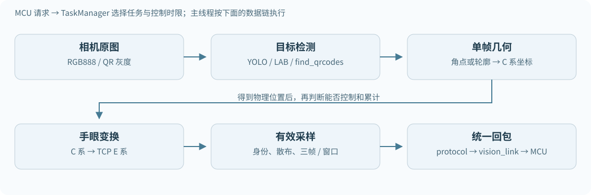
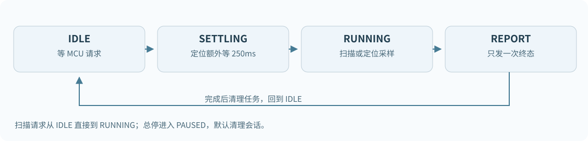
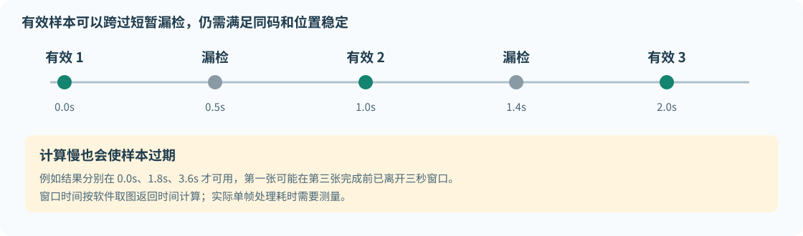
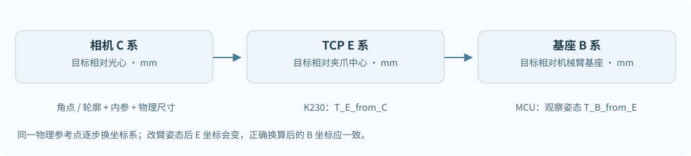

# K230 视觉代码理解与调试手册

阅读对象：需要独立调整和联调排爆反恐救援机器人视觉程序的开发者。源码核对日期：2026 年 11 月 4 日。本文解释当前代码怎样执行、哪些参数真正生效，以及出现问题后应从哪一层检查。

这套程序把视觉处理分成相机取图、检测、几何定位、有效性判断、多帧采样和串口回传。调试时先判断结果停在哪一层，再修改该层的参数。屏幕出现检测框、读出二维码内容、计算出三维坐标、MCU 接受结果，是四个不同的进度。

正文以完整部署目录中的源码为主，同时专门记录 IDE 缓存的差异。本文制作期间没有改动视觉算法、MCU 程序或现场阈值，也没有上传或运行开发板。

- [1 先确认你正在看哪份代码](#1-先确认你正在看哪份代码)
  - [1.1 本文的两份源码](#11-本文的两份源码)
  - [1.2 已确认的版本差异](#12-已确认的版本差异)
- [2 用一张图理解整个项目](#2-用一张图理解整个项目)
- [3 开机以后究竟发生什么](#3-开机以后究竟发生什么)
  - [3.1 启动器和正式入口](#31-启动器和正式入口)
  - [3.2 主循环一轮的执行顺序](#32-主循环一轮的执行顺序)
  - [3.3 三种执行上下文](#33-三种执行上下文)
- [4 相机图像和预览图怎样区分](#4-相机图像和预览图怎样区分)
- [5 正式视觉状态机](#5-正式视觉状态机)
  - [5.1 一次请求和一次结果](#51-一次请求和一次结果)
  - [5.2 用户总停与串口 STOP 的区别](#52-用户总停与串口-stop-的区别)
- [6 MCU 发来的命令怎样选中任务](#6-mcu-发来的命令怎样选中任务)
- [7 扫描计数的三帧与定位三帧是两件事](#7-扫描计数的三帧与定位三帧是两件事)
  - [7.1 扫描阶段怎样得到位置号](#71-扫描阶段怎样得到位置号)
  - [7.2 当前扫描门与释放规则](#72-当前扫描门与释放规则)
- [8 定位三帧究竟怎样累计](#8-定位三帧究竟怎样累计)
  - [8.1 普通定位采样](#81-普通定位采样)
  - [8.2 二维码三秒滚动窗口](#82-二维码三秒滚动窗口)
  - [8.3 哪些事件会清空采样](#83-哪些事件会清空采样)
- [9 二维码完整处理链](#9-二维码完整处理链)
  - [9.1 解码与定位的分工](#91-解码与定位的分工)
  - [9.2 为什么已经读出内容仍不增加采样](#92-为什么已经读出内容仍不增加采样)
  - [9.3 对比度重试中的数字 3](#93-对比度重试中的数字-3)
  - [9.4 二维码调试的先后顺序](#94-二维码调试的先后顺序)
- [10 爆炸物从 YOLO 框到真实球心](#10-爆炸物从-yolo-框到真实球心)
  - [10.1 YOLO 只负责找到它](#101-yolo-只负责找到它)
  - [10.2 分割和轮廓提取](#102-分割和轮廓提取)
  - [10.3 球心为什么不等于检测框中心](#103-球心为什么不等于检测框中心)
- [11 打靶从颜色块到靶心](#11-打靶从颜色块到靶心)
  - [11.1 当前打靶没有走 YOLO](#111-当前打靶没有走-yolo)
  - [11.2 一层 LAB 不够](#112-一层-lab-不够)
  - [11.3 已知双圆几何定位](#113-已知双圆几何定位)
- [12 人质默认定位物体自身](#12-人质默认定位物体自身)
- [13 人质 table 模式保留了什么](#13-人质-table-模式保留了什么)
- [14 像素坐标如何成为 MCU 控制坐标](#14-像素坐标如何成为-mcu-控制坐标)
  - [14.1 四种坐标和单位](#141-四种坐标和单位)
  - [14.2 内参和畸变](#142-内参和畸变)
  - [14.3 手眼接受状态不等于重新标定](#143-手眼接受状态不等于重新标定)
  - [14.4 四类结果的物理参考点](#144-四类结果的物理参考点)
- [15 模型前处理和输出契约](#15-模型前处理和输出契约)
- [16 哪些质量门槛当前实际生效](#16-哪些质量门槛当前实际生效)
- [17 调参位置速查](#17-调参位置速查)
  - [17.1 正式流程与通信](#171-正式流程与通信)
  - [17.2 二维码](#172-二维码)
  - [17.3 爆炸物](#173-爆炸物)
  - [17.4 打靶](#174-打靶)
  - [17.5 人质](#175-人质)
- [18 正式入口与独立测试入口怎样选择](#18-正式入口与独立测试入口怎样选择)
  - [18.1 四个现场脚本的参数](#181-四个现场脚本的参数)
  - [18.2 四类现场测试统一借用二维码通道](#182-四类现场测试统一借用二维码通道)
- [19 屏幕和日志各字段怎么看](#19-屏幕和日志各字段怎么看)
- [20 常见错误码的定位表](#20-常见错误码的定位表)
- [21 串口协议按字节看](#21-串口协议按字节看)
  - [21.1 外层传输](#211-外层传输)
  - [21.2 结果载荷头](#212-结果载荷头)
  - [21.3 本地原因与线上原因](#213-本地原因与线上原因)
- [22 与 MCU 联调时看哪一边](#22-与-mcu-联调时看哪一边)
  - [22.1 屏幕 OK 但 MCU 不进入下一步](#221-屏幕-ok-但-mcu-不进入下一步)
- [23 常见现象的独立排查步骤](#23-常见现象的独立排查步骤)
  - [23.1 二维码一直到不了三帧](#231-二维码一直到不了三帧)
  - [23.2 too many 到底该改哪里](#232-too-many-到底该改哪里)
  - [23.3 检测框很好看但坐标很少](#233-检测框很好看但坐标很少)
  - [23.4 三帧很稳定但测量整体偏了](#234-三帧很稳定但测量整体偏了)
  - [23.5 总停后重新启动，后续任务找不到颜色](#235-总停后重新启动后续任务找不到颜色)
  - [23.6 扫描只记录一个目标或顺序错](#236-扫描只记录一个目标或顺序错)
- [24 怎样测量真正的耗时](#24-怎样测量真正的耗时)
- [25 如何修改代码而不迷失调用关系](#25-如何修改代码而不迷失调用关系)
  - [25.1 改一个参数的基本步骤](#251-改一个参数的基本步骤)
  - [25.2 改检测器时要遵守的结果字段](#252-改检测器时要遵守的结果字段)
  - [25.3 改几何算法时要遵守的结果字段](#253-改几何算法时要遵守的结果字段)
  - [25.4 新增任务或改变结果字段的改动顺序](#254-新增任务或改变结果字段的改动顺序)
- [26 训练视频采集和模型替换](#26-训练视频采集和模型替换)
- [27 离线测试能帮助你验证什么](#27-离线测试能帮助你验证什么)
- [28 一张可复用的现场记录表](#28-一张可复用的现场记录表)
- [附录 A 源码模块和函数导航](#附录-a-源码模块和函数导航)
- [附录 B 当前配置完整索引](#附录-b-当前配置完整索引)
  - [runtime_config.py](#runtime_configpy)
  - [config.py](#configpy)
  - [aim_config.py](#aim_configpy)
  - [rescue_config.py](#rescue_configpy)
  - [field_qr_tcp_test.py](#field_qr_tcp_testpy)
  - [field_bomb_tcp_test.py](#field_bomb_tcp_testpy)
  - [field_aim_tcp_test.py](#field_aim_tcp_testpy)
  - [field_rescue_tcp_test.py](#field_rescue_tcp_testpy)
- [附录 C IDE 缓存文件一致性](#附录-c-ide-缓存文件一致性)
- [附录 D 如何使用离线阅读版](#附录-d-如何使用离线阅读版)

## 1 先确认你正在看哪份代码

### 1.1 本文的两份源码

| 标记 | 电脑位置 | 本文用途 |
| --- | --- | --- |
| A 完整部署源码 | `C:\Users\26617\OneDrive\Desktop\广工赛\K230_Competition_Rescue_20261031\board_files\data\guanggongsai` | 正文架构、默认值和函数关系的主要依据 |
| B 当前 IDE 缓存 | `C:\Users\26617\AppData\Local\Temp\canmv-vscode-Armstrong\6c1bc1fee0ff007f\remote\data\guanggongsai` | 记录你在 CanMV IDE 中打开或现场调整的文件；这只是部分模块的缓存 |

板上的正式模块路径是 `/data/guanggongsai`，启动器是 `/sdcard/main.py`。电脑目录的内容不能证明板上正在运行相同版本：本次读取时 CanMV 工具未连接开发板。

`qr_1080_update/` 是部署目录内保留的一套历史更新文件，正常入口没有导入这个子目录。不要把它当成与根目录同样新的第二套程序。最初的 `visualproject/guanggongsai_complete` 也不作为本手册判断当前运行状态的依据。

手册配套的 `source_manifest.json` 记录了本次阅读文件的 SHA256 和行号。HTML 版源码链接打开的是同一批只读快照，方便边看说明边查代码；Markdown 版链接指向电脑上的原文件。原文件后续修改后，行号和默认值可能变化。

### 1.2 已确认的版本差异

| 位置 | A 完整部署源码 | B IDE 缓存 | 对调试的影响 |
| --- | --- | --- | --- |
| `task_manager.py` | 二维码使用 `QRMeasurementAverage`，支持滚动窗口 | 仍直接使用旧 `MeasurementAverage`，还传入旋转散布参数 | 在 B 中仅设置 `QR_SAMPLE_WINDOW_MS=3000`，不能让正式状态机自动获得窗口逻辑 |
| `qr_pose.py` | 按中心位置歧义和位置不确定度验收 | 仍有 `planar_pose_ambiguous`、`rotation_poorly_observable` | 旧版可能已经解码，但因姿态条件拒绝这张图 |
| `field_tcp_stream.py` | 使用仅位置采样接口和完整检测反馈 | 仍按旧的带旋转参数接口调用采样器，反馈功能也不同 | 不能只覆盖其中一个文件，必须核对其依赖接口 |
| `target_color.py` 粗筛 | `pixels_threshold=40`，`area_threshold=120` | 你已调成 `200`、`900` | B 已有现场修改，上传 A 会覆盖这次调参 |
| `aim_config.py` | 一套初始 LAB 阈值 | 另一套现场 LAB 阈值 | 相同图像可能得到不同色块数量 |
| `config.py` 红球 LAB | `(31,88,18,102,-20,83)` | `(8,88,10,102,-20,83)` | 红球轮廓分割范围不同 |
| `rescue_config.py` | 人质扫描门为全屏，支持轮廓搜索扩展 | 扫描门仍为 `(280,80,80,320)`，扩展配置也不同 | 可看到的目标和计数条件不同 |
| `yolo_detector.py` | 完全落在 letterbox 填充区的框被单独跳过 | 旧版可能将其变为整帧检测失败 | `DETECTION_IN_PADDING_ONLY` 的处理不同 |
| `runtime_config.py` | `MEASUREMENT_SAMPLES=3` | 可执行设置同样为 3，但部分注释仍写 5 帧 | 看赋值和实际调用，不以旧注释判断 |

B 中并没有缓存完整的 `measurement.py`、`task_runner.py` 和 `tasks/`，因此不能只凭这些缓存确定板端最终组合。本手册不把 B 的任意单个文件直接覆盖成 A。

**先做的版本检查：**在实际运行入口里确认模块来源，再确认 `TaskManager.on_command()` 创建的是哪一种采样器。二维码窗口、姿态检查和字段布局都依赖代码版本，不是一个常量就能统一。

```python
# 调试片段：只打印已导入模块的位置，不启动相机、任务或底盘。
import runtime_config, task_manager, measurement, qr_pose
for module in (runtime_config, task_manager, measurement, qr_pose):
    print(module.__name__, getattr(module, "__file__", "<固件未提供路径>"))
print("samples", runtime_config.MEASUREMENT_SAMPLES)
print("qr_window", getattr(runtime_config, "QR_SAMPLE_WINDOW_MS", None))
```

替换 `.py` 后应重启程序或开发板。已经导入的模块可能仍在 `sys.modules` 中，磁盘文件改变不等于内存中的类已经更新。

## 2 用一张图理解整个项目



| 层次 | 主要文件 | 输入 | 输出 | 这层不负责什么 |
| --- | --- | --- | --- | --- |
| 启动与调度 | `competition_main.py`、`run_control.py` | 用户键、串口命令 | 调度相机和当前任务 | 不计算机器人整条行驶路线 |
| 相机 | `camera_service.py` | Sensor0 | 原图、帧号、相机 epoch | 不把预览坐标当标定坐标 |
| 检测 | `yolo_detector.py`、`target_color.py`、QR 库函数 | 原始图像 | 类别、检测框或二维码四角 | 检测框本身不是可靠的三维位置 |
| 几何定位 | `qr_pose.py`、`geometry.py`、`target_pose.py`、`rescue_object_pose.py` | 角点或轮廓、内参、已知尺寸 | 相机坐标系下的毫米坐标 | 不控制电机和机械臂 |
| 任务适配 | `tasks/`、`task_runner.py` | 检测和定位结果 | 统一的 observation 字典 | 不直接发串口 |
| 多帧与状态机 | `measurement.py`、`task_manager.py` | 当前请求、逐帧 observation | 一次终态结果 | 不确认舵机是否真的停稳 |
| 通信 | `protocol.py`、`vision_link.py` | 请求或结果字段 | AA55 数据包 | 不推测下一项物理任务 |

建议第一次按这个顺序读：`runtime_config.py` → `competition_main.run_loop()` → `TaskManager.on_command()/poll_frame()` → `VisionTaskFactory.start()` → 你正在调的 `tasks/task_*.py` → 对应几何算法 → `measurement.py` → `protocol.py`。

不用一开始就钻进矩阵求解器。先掌握数据从哪里进来、什么条件会返回 `ok=False`、结果到哪里被计数，调试效率更高。

## 3 开机以后究竟发生什么

源码入口：[competition_main.py · main · L172](<C:/Users/26617/OneDrive/Desktop/广工赛/K230_Competition_Rescue_20261031/board_files/data/guanggongsai/competition_main.py:172>)；循环：[competition_main.py · run_loop · L105](<C:/Users/26617/OneDrive/Desktop/广工赛/K230_Competition_Rescue_20261031/board_files/data/guanggongsai/competition_main.py:105>)。

### 3.1 启动器和正式入口

`/sdcard/main.py` 先把 `/data/guanggongsai` 放到 `sys.path` 前面，再执行：

```python
from competition_main import main
main()
```

正式 `main()` 创建 UART、加载相机和手眼标定、创建任务工厂、相机服务、任务状态机和用户按键控制器。标定加载失败时使用 `UnavailableFactory`，收到请求后明确报告 `CALIBRATION_NOT_READY`。

相机对象的创建不等于已经开始取图。`RunControl` 初始将任务管理器暂停并关闭命令接收，程序等待 GPIO53 的一次新按键。按下后通过串口发送总启动消息，恢复任务管理器，再开始相机工作。

### 3.2 主循环一轮的执行顺序

1. 处理用户键。如果没有启动，刷新等待界面并跳过取图和识别。
2. 从接收线程的队列取 MCU 命令，优先处理 `STOP`；检查任务是否超时。
3. 按当前任务切换二维码灰度通道需求，取一组图像。
4. 再处理用户键、串口和超时。取图期间到来的新请求可以使刚取到的旧图作废。
5. 把这张图交给当前任务处理。
6. 识别后再次处理按键、命令、超时，再发送结果。
7. 更新屏幕和诊断，释放本轮图像引用，`gc.collect()`，最后休眠 `LOOP_SLEEP_MS`。

这个顺序是为了让取图或推理期间收到的停止命令优先于回传旧坐标。`LOOP_SLEEP_MS=5` 只是循环尾部休眠，不代表整轮只需 5ms，更不代表视觉固定 200fps。

### 3.3 三种执行上下文

| 上下文 | 工作 | 注意点 |
| --- | --- | --- |
| 串口后台线程 | 接收字节、拼包、CRC、放入命令队列 | 不运行 YOLO、几何定位或底盘任务 |
| 按键后台线程 | GPIO 读取、消抖、累计按键事件 | 不直接发送启动消息 |
| 主线程 | 执行启停、相机、视觉、任务状态和回包 | 一次耗时计算会推迟下一次主线程轮询 |

后台能收命令，并不表示主线程能立刻打断正在执行的库函数。当前代码在重计算前后检查停止，而不是抢占式取消一次 `find_qrcodes()` 或几何拟合。

## 4 相机图像和预览图怎样区分

源码：[camera_service.py · CameraService._create_sensor · L68](<C:/Users/26617/OneDrive/Desktop/广工赛/K230_Competition_Rescue_20261031/board_files/data/guanggongsai/camera_service.py:68>)；取图：[camera_service.py · CameraService.get_frame · L125](<C:/Users/26617/OneDrive/Desktop/广工赛/K230_Competition_Rescue_20261031/board_files/data/guanggongsai/camera_service.py:125>)。

| 用途 | 传感器与通道 | 尺寸和格式 | 使用者 |
| --- | --- | --- | --- |
| 原始彩色图 | Sensor0，通道 0 | 640×480，RGB888 | 爆炸物、人质 YOLO，颜色和轮廓算法 |
| 二维码高分辨率图 | 同一 Sensor0，通道 1 | 1920×1080，灰度 | 开启二维码任务时使用 |
| 屏幕画布 | 显示输出 | 800×480 | 中文状态、图像预览、检测框 |
| 网络输入 | KPU/ai2d | 640×640，uint8 NCHW RGB | YOLO 模型 |

屏幕画布、网络输入、640×480 原图和 1080p 二维码图是不同坐标空间。`bbox_raw_px` 明确指原图坐标。不要把屏幕上量出的矩形像素直接写进 `SCAN_GATE_RAW_PX`。

二维码通道设计为同一完整视场、不额外裁剪或翻转。`QRTask` 按 `sx=1920/640=3`、`sy=1080/480=2.25` 分别缩放内参的两行；不是把所有内参都乘 3。该做法依赖实际 ISP 通道确实维持相同视场，修改采集几何后需要重新核对。

`frame` 字典的重要字段：

| 字段 | 含义 |
| --- | --- |
| `image` | 640×480 RGB888 原图对象 |
| `qr_image` | 可选的高分辨率灰度图 |
| `frame_id` | 软件递增的本次图像编号，用于避免重复计数 |
| `capture_return_ms` | 本轮取图返回时的软件时间戳，不是硬件曝光起点 |
| `epoch` | 相机重建或二维码通道需求切换的代号 |
| `geometry_confirmed` | 配置对原图几何一致性的声明 |
| `qr_geometry_confirmed` | 二维码通道对应声明 |

`RAW_GEOMETRY_CONFIRMED=True` 是开发者配置，不是程序实时验证了相机安装、畸变和视场。

相机先热身 10 帧；取图超时阈值为 200ms。连续达到 3 次取图失败后尝试重建，重建次数上限为 2，等待 200ms。相机 epoch 变化会清空定位采样；已经开始的扫描若发生相机切换/重建，还可能直接报 `CAMERA_ERROR`，防止把不同阶段的扫描拼成一条顺序。

## 5 正式视觉状态机

创建任务：[task_manager.py · TaskManager.on_command · L178](<C:/Users/26617/OneDrive/Desktop/广工赛/K230_Competition_Rescue_20261031/board_files/data/guanggongsai/task_manager.py:178>)；逐帧处理：[task_manager.py · TaskManager.poll_frame · L244](<C:/Users/26617/OneDrive/Desktop/广工赛/K230_Competition_Rescue_20261031/board_files/data/guanggongsai/task_manager.py:244>)。



| 状态 | 做什么 | 常见出口 |
| --- | --- | --- |
| `IDLE` | 等待 MCU 请求；启动后可以保持相机热身 | 收到任务命令 |
| `SETTLING` | 定位任务额外等待 250ms | 时间到进入 `RUNNING`，或超时 |
| `RUNNING` | 扫描确认顺序，或检测、定位、采样 | 成功、终止错误、超时、新命令抢占 |
| `REPORT` | 等待统一发送一次终态结果 | 清理任务后回到 `IDLE` |
| `PAUSED` | 总控制关闭或暂停 | 用户启动或恢复 |

扫描任务不等待定位用的停稳时间。定位任务把 `stable=True` 传给算法，只表示 MCU 和调用方声明已经停稳；K230 没有读取舵机反馈来证明停稳。

`TaskManager` 控制四件事：请求匹配、时间限制、采样、回包。`VisionTaskFactory` 负责选择哪一个任务类，并缓存二维码选中的任务和扫描结果。具体任务类只负责观察。

### 5.1 一次请求和一次结果

正式模式每个接受的请求只尝试发送一次终态结果，不持续发送坐标，没有 ACK 和自动重发。新任务可以取消旧任务；`STOP=0x7F` 可终止正在执行的任务。

请求去重键为 `(SEQ, CMD, PAYLOAD)`。正在执行的同键请求以及 5 秒历史窗口内的同键请求会被忽略。MCU 要重新测量时，应使用新的请求序号；反复发送同一个完整包不一定重新启动采样。

定位和扫描超时当前都是 60000ms，从请求开始计时，包含停稳等待、取图、模型加载和计算。超时检查位于主线程检查点：某个函数阻塞时，不会在第 60000ms 的瞬间把它抢占退出。

### 5.2 用户总停与串口 STOP 的区别

源码：[run_control.py · RunControl._stop · L33](<C:/Users/26617/OneDrive/Desktop/广工赛/K230_Competition_Rescue_20261031/board_files/data/guanggongsai/run_control.py:33>)。

当前 `TOTAL_STOP_POLICY="restart"`：按用户键停止会清理当前任务、请求去重历史、二维码选择和三类扫描映射，与 MCU 总停后回到初始任务的约定对应。再次启动应重新走扫码和后续流程。

可选的 `"pause"` 保留任务上下文，但仍清空未完成的定位采样，恢复后重新停稳采样；暂停期间不累计有效任务耗时。修改此项前要同步理解 MCU 是否继续原步骤。

## 6 MCU 发来的命令怎样选中任务

源码：[protocol.py · decode_command · L57](<C:/Users/26617/OneDrive/Desktop/广工赛/K230_Competition_Rescue_20261031/board_files/data/guanggongsai/protocol.py:57>)；工厂：[task_runner.py · VisionTaskFactory.start · L180](<C:/Users/26617/OneDrive/Desktop/广工赛/K230_Competition_Rescue_20261031/board_files/data/guanggongsai/task_runner.py:180>)。

| CMD | 名称 | 作用 | 正式成功时的主要结果 |
| --- | --- | --- | --- |
| `0x10` | `QR_START` | 解读任务码并定位二维码 | 二维码中心 E 系位置；任务码留在 K230 |
| `0x20` | `BOMB_SCAN` | 确认三个爆炸物颜色的出现顺序 | 选中颜色对应的 `target_slot` |
| `0x21` | `BOMB_MEASURE` | 定位选中颜色的球心 | 球心 E 系位置 |
| `0x30` | `AIM_SCAN` | 确认三个靶色的出现顺序 | 选中颜色对应的位置号 |
| `0x31` | `AIM_MEASURE` | 定位选中靶色的靶心 | 靶心 E 系位置 |
| `0x40` | `RESCUE_SCAN` | 确认三种人质形状顺序 | 选中形状对应的位置号 |
| `0x41` | `RESCUE_MEASURE` | 定位选中形状的人质 | 默认返回物体轴线中点 E 系位置 |
| `0x7F` | `STOP` | 停止当前视觉请求 | 当前请求的取消结果；空闲时静默 |
| `0x02` | `HEARTBEAT` | MCU→K230 的心跳 | 正式管理器忽略，不启动任务 |

二维码和 STOP 请求必须为空载荷。扫描请求可为空或带 1 字节目标 ID；定位请求可为空、带目标 ID，或带目标 ID 和位置号。非零 ID 都应为 1、2、3；0 被解释为未指定。

颜色 ID：1 红、2 绿、3 蓝。人质形状 ID：1 圆柱、2 圆台、3 腰鼓。模型 class ID 从 0 开始，适配器转换成比赛 ID 时加 1，不能直接混用。

空载荷任务会从最近成功二维码中补全目标。若定位未指定位置号，工厂尝试从该任务的扫描映射里补全。只有 table 人质模式强制要求已知位置号；默认 object 模式与爆炸物、打靶可按明确目标 ID 单独定位。

开始新二维码任务会清空旧任务选择和三种扫描映射。一次扫描开始时也会清空该类旧映射，完成后再提交新的映射。

## 7 扫描计数的三帧与定位三帧是两件事

公用扫描器：[tasks/task_bomb.py · BombScanSession.update · L267](<C:/Users/26617/OneDrive/Desktop/广工赛/K230_Competition_Rescue_20261031/board_files/data/guanggongsai/tasks/task_bomb.py:267>)。打靶复用它，人质通过 `RescueScanSession` 把 `shape_id` 转成相同的三身份序列规则。

### 7.1 扫描阶段怎样得到位置号

1. 对每帧候选框，检查中心是否在扫描门内。
2. 门内应只有一个可确认目标。目标身份相同、中心移动不超过 `SCAN_MAX_STEP_PX=60` 时，连续命中次数增加。
3. 命中达到 `SCAN_MIN_HITS=3`，把这个身份追加到首次确认顺序。
4. 三个不同身份都确认后自动完成，不需要额外发送“扫描结束”。

例如观察顺序为绿、红、蓝，即 `[2,1,3]`，映射是 `{2:1, 1:2, 3:3}`。二维码若选择红色，回传目标位置号就是 2。位置号是本次受控扫描的先后顺序，不是检测列表顺序，也不是程序根据图像左右位置推断出的地图编号。

MCU 负责从第一个目标之前开始、沿一致方向扫描；`SCAN_ORDER_CONFIRMED=True` 和 `SCAN_START_BOUNDARY_CONFIRMED=True` 只是工厂对这个前提的声明。

### 7.2 当前扫描门与释放规则

| 任务 | A 中扫描门 `(x,y,w,h)` | 说明 |
| --- | --- | --- |
| 爆炸物 | `(160,80,320,320)` | VGA 中间 320×320 |
| 打靶 | `(240,160,160,160)` | VGA 中间 160×160 |
| 人质 | `(0,0,640,480)` | A 为全屏；B 仍是较窄门 |

当前 `SCAN_REQUIRE_BLANK_GAP=False`：确认一个身份后，允许直接确认新的未记录身份；已记录身份会被忽略。`SCAN_RELEASE_FRAMES=2` 在严格释放模式中更关键，不能把它当成定位采样数。

当前多个目标入门时，歧义计数达到 `SCAN_MAX_AMBIGUOUS_FRAMES=3` 会报告 `SCAN_MULTIPLE_TARGETS_IN_GATE`。单个合格目标帧或 `drop_frame()` 会清零该计数；当前代码的无目标帧没有显式清零它，因此不应简单理解成严格连续的三张多目标图。短暂歧义会打断当前未完成的命中，但检测失败通过 `drop_frame()` 不会删除已经确认的顺序。

扫描确认三帧表示“这一身份可靠出现了”，此时可以完全不做球心/靶心/人质三维拟合。扫描成功包的 `sample_count=0`，不能拿定位结果的“必须 3 帧且有 XYZ”验收函数去验扫描包。

## 8 定位三帧究竟怎样累计

源码：[measurement.py · MeasurementAverage.add · L27](<C:/Users/26617/OneDrive/Desktop/广工赛/K230_Competition_Rescue_20261031/board_files/data/guanggongsai/measurement.py:27>)；二维码特例：[measurement.py · QRMeasurementAverage.add · L75](<C:/Users/26617/OneDrive/Desktop/广工赛/K230_Competition_Rescue_20261031/board_files/data/guanggongsai/measurement.py:75>)。

### 8.1 普通定位采样

一张新图计算出有效 observation，就贡献一个样本；三张有效图得到一组均值，没有“先三次识别再折算成一帧”的嵌套门槛。

普通采样器检查：帧号递增、`ok=True`、坐标为有限三维数、单位为 mm、坐标系为 `E_commanded_gripper_center`、目标身份一致。失败 observation 会清空累计窗口。

均值为三个位置分量分别求平均。`scatter_mm` 是各样本到该组均值的**最大三维欧氏距离**，不是方差、标准差，也不是每个轴分别允许 8mm。散布超过 `MAX_POSITION_SCATTER_MM=8.0` 时，保留最新一个样本，从它重新累计。

例如点 A、B、C 的均值为 M，要求 `max(|A-M|, |B-M|, |C-M|) ≤ 8mm`。它衡量短期稳定性，不代表结果距离真实位置也只有 8mm；系统性标定误差可让三帧非常稳定但都偏离真实值。

当前正式工厂构造 `AimTask(..., measure_hits=1)`，table 人质也使用 `measure_hits=1`；默认 object 人质每张图完成一次模型拟合，爆炸物每张图完成一次球心拟合。因此正式流程由外层统一累计 3 帧。直接单独构造任务类时，其默认 `measure_hits=3` 可能另外生效，应查看调用方式。

### 8.2 二维码三秒滚动窗口



A 的二维码在 3000ms 内累计 3 个有效定位样本：

- `QR_NOT_FOUND` 可以桥接，之前的有效样本在未过期时保留。
- 已确认是同一个任务码时，`qr_center_ambiguous`、`qr_position_uncertain` 也允许短暂桥接，但这些失败帧不计数。
- 换了任务码、多二维码、无效任务码等情况会清空旧样本，防止混码。
- 老样本每次按 `capture_return_ms` 判断年龄，过期样本被移出。当前帧在计算完成时已经超过 3 秒，则返回 `QR_SAMPLE_EXPIRED` 并清空。
- 几何正确但样本位置跳动过大，仍会触发普通散布检查。

成功、漏检、成功、漏检、成功可以完成一组，不要求五张图都成功。时间窗包含图像返回之后的计算耗时，不是只有等待时间。

三秒也不是任务总超时：任务总时限为 60 秒，期间可以不断尝试新的三秒有效样本窗口。把窗口设为 0 时，A 的正式二维码恢复普通连续有效结果模式。B 的旧正式管理器没有接入这个分支；旧 `qr_tcp_stream.py` 也直接使用普通采样器。

### 8.3 哪些事件会清空采样

| 事件 | 结果 |
| --- | --- |
| 新请求、目标身份变化 | 新建或重置窗口 |
| 普通定位失败一帧 | 清空普通采样窗口 |
| QR 允许桥接的短暂失败 | 未过期的同码样本保留 |
| 位置散布超过 8mm | 只保留最新样本 |
| 相机 epoch 改变 | 清空定位窗口 |
| 暂停和恢复 | 丢弃未完成的定位样本，重新停稳 |
| 独立测试完成一组并发包 | 清空，下一组使用新的非重叠样本 |

## 9 二维码完整处理链

任务入口：[tasks/task_qr.py · QRTask.measure · L47](<C:/Users/26617/OneDrive/Desktop/广工赛/K230_Competition_Rescue_20261031/board_files/data/guanggongsai/tasks/task_qr.py:47>)；库函数调用：[qr_pose.py · QRPoseEstimator.detect · L416](<C:/Users/26617/OneDrive/Desktop/广工赛/K230_Competition_Rescue_20261031/board_files/data/guanggongsai/qr_pose.py:416>)；几何：[qr_pose.py · QRPoseEstimator.estimate_from_corners · L332](<C:/Users/26617/OneDrive/Desktop/广工赛/K230_Competition_Rescue_20261031/board_files/data/guanggongsai/qr_pose.py:332>)。

### 9.1 解码与定位的分工

底层通过 `img.find_qrcodes()` 找码，读取 `code.payload()` 和 `code.corners()`。二维码内容只接受长度恰好为 3、每位为字符 1/2/3 的字符串。例如 `123`、`211` 合法；`123\n`、空格、网址不合法，也不会自动 `strip()`。

三位依次选择：爆炸物颜色、靶标颜色、人质形状。图像里出现多个二维码时返回 `MULTIPLE_QRS_AMBIGUOUS`，没有自动选最大码。

四角是原图中的二维码四个物理角点，不是 `rect()` 外接框四角。算法按二维码 80mm 边长、相机内参和畸变求物理位置。

### 9.2 为什么已经读出内容仍不增加采样

几何处理包括角点检查、去畸变、单应初值、多初值迭代优化和位置可靠性检查。多个平面模型可能方向不同但中心相近，A 只按中心是否一致和位置是否可靠验收，不输出朝向控制量。

| 检查 | A 当前设置或机制 | 失败码 |
| --- | --- | --- |
| 有效新帧与停稳声明 | 帧号递增、`stable=True` | `STALE_OR_DUPLICATE_FRAME`、`OBSERVATION_NOT_STABLE` |
| 图像几何 | 尺寸与推导内参匹配、角点在图内、角点顺序合理 | `image_size_mismatch`、`nonconvex_mirrored_or_wrong_corner_winding` 等 |
| 至少有收敛位置模型 | 最多约 6 组初值，每组最多 35 轮 | `no_converged_position_model` |
| 多模型中心一致 | 最大中心差 ≤ 8mm | `qr_center_ambiguous` |
| 位置不确定度 | 模型估计的 3σ 指标 ≤ 25mm | `qr_position_uncertain` |
| 手眼变换 | 有矩阵；控制使用时已接受 | `HANDEYE_NOT_CONFIGURED` 或观察状态 |
| 多帧稳定 | 三帧最大散布 ≤ 8mm | `POSITION_NOT_STABLE` |

这里的 3σ 是在角点噪声假设下计算的工程指标，不是实物重复测量得到的保证精度。优化器的多组初值都来自**同一张图的角点**，不会把多张图偷偷合成一帧。

### 9.3 对比度重试中的数字 3

连续 3 次没有读出码时，A 会复制同尺寸灰度图，做 `histeq(adaptive=False)` 后再次检测。它只改变亮度分布，不改几何坐标。这是增强重试的触发次数，和最终 `MEASUREMENT_SAMPLES=3` 无关。

原图每次都会先尝试检测。已经找到二维码但位置不可靠时，不会靠这一条件反复做增强来替代几何检查。

### 9.4 二维码调试的先后顺序

1. `QR_NOT_FOUND`：先看清晰度、曝光、反光、遮挡、码在画面中占的大小和实际库返回数量；暂时不改位置散布。
2. 已有 payload、失败为位置错误：检查角点、实际边长、内参对应的视场、距离及多解指标。
3. 有效定位偶尔出现：看是否在窗口内过期、是否使用了旧管理器、是否因位置跳动重新累计。
4. K230 已回传成功：转去检查 MCU 的请求序号、CMD、样本数和坐标变换，停止盲调二维码检测。

当前 1080p 全图检测再加 Python 多初值优化，计算量明显大于只解码一张图。实机耗时需要拆开测量，不能由 `LOOP_SLEEP_MS` 或屏幕刷新频率推断。

## 10 爆炸物从 YOLO 框到真实球心

任务：[tasks/task_bomb.py · BombTask.poll · L366](<C:/Users/26617/OneDrive/Desktop/广工赛/K230_Competition_Rescue_20261031/board_files/data/guanggongsai/tasks/task_bomb.py:366>)；轮廓：[tasks/task_bomb.py · extract_ball_boundary · L50](<C:/Users/26617/OneDrive/Desktop/广工赛/K230_Competition_Rescue_20261031/board_files/data/guanggongsai/tasks/task_bomb.py:50>)；几何：[geometry.py · fit_sphere_center · L161](<C:/Users/26617/OneDrive/Desktop/广工赛/K230_Competition_Rescue_20261031/board_files/data/guanggongsai/geometry.py:161>)。

处理链为：原始 RGB888 → YOLO 找颜色和框 → 选中目标颜色且中心在工作门内 → RGB565 上分割颜色 → 最大连通区域和外边界 → 已知直径球体的轮廓几何拟合 → C 系球心 → 手眼变换成 E 系 → 外层三帧均值。

### 10.1 YOLO 只负责找到它

爆炸物使用 `models/bomb_best.kmodel`，类别顺序为 `red_bomb`、`green_bomb`、`blue_bomb`。框仅用于确定初始计算范围，模型应框住彩球本体而不是下面的支撑管。

同一目标颜色出现多个合格框时，程序拒绝猜选；中心必须在 `(160,80,320,320)` 工作门内。门限制的是目标资格，后续轮廓搜索窗口仍可以扩展到全图，两者不矛盾。

### 10.2 分割和轮廓提取

`config.BOMB_LAB_THRESHOLDS` 按颜色 ID 取 LAB 六元组。板端优先在 RGB565 副本上用原生 `binary()` 分割；没有该原生接口的主机图像才使用参考 RGB→LAB 转换。未配置 LAB 的颜色走 HSV 备用规则。

轮廓窗口在检测框周围加边距，再按 `CONTOUR_MAX_CELLS=12000` 自动决定采样步长。这里的 `CONTOUR_MIN_PIXELS=40` 实际比较的是网格连通分量的采样点数，不是固定对应 40 个全分辨率像素。

最大颜色分量过小报 `COLOR_COMPONENT_TOO_SMALL`；第二大分量超过最大分量的 35% 报 `MULTIPLE_COLOR_COMPONENTS`。边界接触窗口时可扩展搜索。外部背景洪泛填充用于区分外轮廓与内部高光，最多保留 192 个边缘点。

### 10.3 球心为什么不等于检测框中心

`fit_sphere_center()` 将畸变像素变为相机射线，拟合已知球体轮廓形成的切锥。球半径为 20mm，若切锥半角为 α，球心距离满足 `d=20/sin(α)`，再沿拟合轴方向得到三维球心。

算法包含有界 RANSAC 和重拟合，质量字典里有轮廓 RMS、内点比例、覆盖角等。球体本身不能提供可用朝向，因此 `orientation_valid=False` 是正常情况。

**调参对应关系：**框找不到调 YOLO；框正确但颜色分量错调 LAB；轮廓正确但距离缩放错先核对真实球直径和标定；E 坐标跟随臂姿态不一致时检查手眼和 MCU 使用的末端位姿。

## 11 打靶从颜色块到靶心

粗检测：[target_color.py · ColorTargetDetector.detect · L163](<C:/Users/26617/OneDrive/Desktop/广工赛/K230_Competition_Rescue_20261031/board_files/data/guanggongsai/target_color.py:163>)；内外环：[target_color.py · extract_target_rings · L49](<C:/Users/26617/OneDrive/Desktop/广工赛/K230_Competition_Rescue_20261031/board_files/data/guanggongsai/target_color.py:49>)；几何：[target_pose.py · fit_target_center · L142](<C:/Users/26617/OneDrive/Desktop/广工赛/K230_Competition_Rescue_20261031/board_files/data/guanggongsai/target_pose.py:142>)；任务：[tasks/task_aim.py · AimTask.poll · L86](<C:/Users/26617/OneDrive/Desktop/广工赛/K230_Competition_Rescue_20261031/board_files/data/guanggongsai/tasks/task_aim.py:86>)。

### 11.1 当前打靶没有走 YOLO

打靶首先把原图转为 RGB565，调用：

```python
blobs = rgb.find_blobs(
    settings.LAB_THRESHOLDS,
    pixels_threshold=40, area_threshold=120,
    merge=False, x_stride=2, y_stride=2)
```

这是 A 的参数；B 的同一位置已是 `200、900`。

| 参数 | 本程序中调它影响什么 |
| --- | --- |
| `pixels_threshold` | 排除匹配颜色像素数量过少的色块 |
| `area_threshold` | 排除外接矩形面积过小的色块 |
| `merge=False` | 不把候选色块进一步合并成更大的候选 |
| `x_stride=2, y_stride=2` | 调整起始搜索采样步进，影响搜索速度与小区域发现能力；不是输出坐标缩小为一半 |
| `MAX_CANDIDATES=9` | 粗检测色块数量上限，超出会先报 too many |

六元组顺序是 `(L_min,L_max,A_min,A_max,B_min,B_max)`。`blob.code()` 是阈值命中的位掩码，1、2、4 对应红、绿、蓝；命中多个颜色规则时作为歧义候选跳过。

### 11.2 一层 LAB 不够

粗检测使用 `aim_config.LAB_THRESHOLDS`，但内外环精提取里的 `_color_matches()` 当前使用 `HUE_DEG`、`MIN_SATURATION`、`MIN_VALUE` 的 HSV 规则。因此“粗框正确，但精提取没边缘”时，也要检查 HSV 门限，不能只调整 LAB。

程序寻找最大颜色连通区域，再区分外围背景和最大的内部非彩色孔。小高光不作为物理内环。正常靶色环的外边界和内孔边界分别提供外、内圆轮廓。

外环和内环分别最多保留 96 点，几何入口仍要求至少 24 个外环点和 20 个内环点。关闭边界限制后可以使用可见边缘分类处理不闭合区域，但没有足够有效点时仍不能生成坐标。

### 11.3 已知双圆几何定位

当前物理外径 100mm、内径 55mm。算法把这两个同平面、同中心的已知圆一起拟合，估计物理中心和用于计算的法向，并检查竞争解的中心差和位置不确定度。

正式上报只使用中心位置，不把圆形目标无法确定的面内旋转伪造成 yaw。`TARGET_CENTER_AMBIGUOUS` 的竞争中心差阈值 3mm 写在 `target_pose.py`，不是 `MAX_POSITION_SCATTER_MM`。

定位目标中心还必须在 `(240,160,160,160)` 工作门内。这个 160×160 矩形限制候选中心是否有资格，不要求整个靶环都装进该矩形。

`LASER_OFFSET_COMPENSATED=False` 表示当前按约定未补偿激光安装偏移。视觉成功只表示靶心定位通过，不表示已经发射，更不表示命中；本任务也没有命中反馈检测。

## 12 人质默认定位物体自身

入口：[tasks/task_rescue_object.py · RescueObjectTask.poll · L23](<C:/Users/26617/OneDrive/Desktop/广工赛/K230_Competition_Rescue_20261031/board_files/data/guanggongsai/tasks/task_rescue_object.py:23>)；模型：[rescue_object_pose.py · body_surface · L14](<C:/Users/26617/OneDrive/Desktop/广工赛/K230_Competition_Rescue_20261031/board_files/data/guanggongsai/rescue_object_pose.py:14>)；拟合：[rescue_object_pose.py · RescueObjectEstimator.fit · L103](<C:/Users/26617/OneDrive/Desktop/广工赛/K230_Competition_Rescue_20261031/board_files/data/guanggongsai/rescue_object_pose.py:103>)。

当前 `RESCUE_REFERENCE_MODE="object"`，使用 `rescue_best.kmodel` 识别圆柱、圆台、腰鼓。选中形状应只有一个候选。A 的扫描门为全屏，定位不依赖整张台面四角可见。

| 已知形状尺寸 | 当前数值 |
| --- | --- |
| 三类高度 | 70mm |
| 圆柱直径 | 50mm |
| 圆台上直径、下直径 | 30mm、50mm |
| 腰鼓端部直径 | 30mm |
| 腰鼓侧面圆弧半径 | 66mm |

检测框周围提取灰度图，按直方图自动寻找分割阈值，并设置阈值下限 55。寻找框内支持最多的白色连通分量，明显存在第二个大分量时拒绝；计算窗口接触边界时按配置扩展。轮廓最多保留 192 点，采样噪声估计与采样步长关联。

几何算法按已知旋转体生成表面采样点，用多个方向的投影支持函数比较模型轮廓和观察轮廓，迭代拟合三维中心及计算需要的轴方向。它使用上一帧解作为部分初值，但仍对当前图像计算，上一帧不是一张新的有效样本。

返回参考点为 `rescue_object_axis_midpoint`，即物体轴线中点；不是台面孔中心，也不是自动生成的夹取接触点。当前 `grasp_position_tool_mm=None`。这些旋转对称物体绕自身轴的转角不作为控制输出。

仍保留的位置门槛包括物理深度 100～1800mm、竞争中心间隔 10mm、位置 3σ 指标上限 25mm。白色轮廓连上台面、背景或被遮挡时，应先检查图像和分割，不能把 YOLO 框中心加一个假设深度当成可靠 XYZ。

## 13 人质 table 模式保留了什么

入口：[tasks/task_rescue.py · RescueTask.poll · L157](<C:/Users/26617/OneDrive/Desktop/广工赛/K230_Competition_Rescue_20261031/board_files/data/guanggongsai/tasks/task_rescue.py:157>)；参照：[rescue_reference.py · NativeRescueTableReference.observe · L128](<C:/Users/26617/OneDrive/Desktop/广工赛/K230_Competition_Rescue_20261031/board_files/data/guanggongsai/rescue_reference.py:128>)；几何：[rescue_geometry.py · RescueTablePoseEstimator.estimate_table · L64](<C:/Users/26617/OneDrive/Desktop/广工赛/K230_Competition_Rescue_20261031/board_files/data/guanggongsai/rescue_geometry.py:64>)。

把 `RESCUE_REFERENCE_MODE` 改为 `"table"` 后，任务利用矩形台面和已知槽位几何定位固定参照点。`find_rects()` 只找候选，后面还要确认四角物理顺序、台面尺寸、黑色比例和目标与槽位的对应关系。

`models/rescue_table.template.json` 目前仍有 `dimensions_confirmed=false`、槽位中心为空、方向和高度未确认等项。因此不能仅切换一个字符串就期望该模式工作。

| 两种模式 | object 当前默认 | table 备选 |
| --- | --- | --- |
| 依赖可见内容 | 人质自身轮廓 | 足够的台面矩形和槽位参照 |
| 返回点 | 物体轴线中点 | 台面坐标系中已定义的槽位点 |
| 是否固定地标 | `reference_is_fixed=False` | 固定参照 |
| 夹取点 | 当前不生成 | 只有高度和相关配置确认后才可生成 |
| 调参位置 | `rescue_object_pose.py`、object 配置 | `rescue_reference.py`、layout JSON、table 配置 |

`rescue_geometry.py` 复用了二维码单应与位置计算的底层数学，物理模型换成已知长方形。不要把 object 模式的错误和 table 模式的参数混着调。

## 14 像素坐标如何成为 MCU 控制坐标



相机模型：[geometry.py · CameraModel · L56](<C:/Users/26617/OneDrive/Desktop/广工赛/K230_Competition_Rescue_20261031/board_files/data/guanggongsai/geometry.py:56>)；手眼：[calibration_params.py · Calibration.point_to_tool · L20](<C:/Users/26617/OneDrive/Desktop/广工赛/K230_Competition_Rescue_20261031/board_files/data/guanggongsai/calibration_params.py:20>)；加载：[calibration_params.py · load_calibration · L33](<C:/Users/26617/OneDrive/Desktop/广工赛/K230_Competition_Rescue_20261031/board_files/data/guanggongsai/calibration_params.py:33>)。

### 14.1 四种坐标和单位

| 名称 | 原点和方向 | 单位 | 常见字段 |
| --- | --- | --- | --- |
| 原图像素 | 左上角，u 向右、v 向下 | px | `corners_px`、`bbox_raw_px` |
| 相机 C | 光心，X 向右、Y 向下、Z 向前，与投影模型一致 | mm | `position_camera_mm` |
| 夹爪 TCP E | 标定定义的 commanded gripper center | mm | `position_tool_mm` |
| MCU 基座 B | 机械臂基座原点，X 右、Y 前、Z 上 | mm | MCU 换算后的 `reference_body` 等 |

E 的轴向应由手眼标定和机械臂模型共同理解，不要直接等同于相机轴或 B 轴。机械臂位置命令的 +X 向左，与 B 系 +X 向右不同；MCU 的现有变换和 `field_tcp_reference.py` 已处理这一点。

手眼变换方向为：

```text
p_E = R_E_C × p_C + t_E_C
p_B = R_B_E × p_E + t_B_E
```

第一步在 K230，第二步主要在 MCU，必须使用拍照时对应的机械臂观察姿态。`position_tool_mm` 是目标相对 TCP 的位置，不是 TCP 相对目标的位置，也不是底盘在地图中的位置。

同一固定目标，改变机械臂姿态后 E 坐标改变是正常的；使用正确末端变换后，B 坐标应保持一致。不能为了让 E 坐标固定而给视觉输出加常量。

### 14.2 内参和畸变

当前相机内参文件为 `calibration/results/camera_params.json`，对应 640×480：`fx≈540.242`、`fy≈719.861`、`cx≈320.099`、`cy≈248.379`。完整数值和 D 以文件为准，不用手抄本文四舍五入值替换标定。

`geometry.CameraModel.ray()` 从畸变像素求归一化视线，`project_ray()` 做对应投影。二维码和表面模型各自用已知物理尺寸消除单目尺度不确定性。修改球直径、二维码边长、靶环直径或人质尺寸，会直接改变距离尺度。

不要用 `lens_corr()`、裁剪、旋转或图像缩放后的位置直接套旧内参。图像增强若不改像素几何通常不涉及同类问题，但仍应检查库实际行为。

### 14.3 手眼接受状态不等于重新标定

`load_calibration()` 读取现有 `T_tool_from_camera`。当前 `HANDEYE_ACCEPTED_BY_USER=True` 使已有矩阵在运行时被接受，原 JSON 中的历史质量记录仍保留。

该历史记录写有留出固定板平移一致性约 23.7mm RMS。这是历史验证值，不是今天工况的测量结果，也不能把开启接受标志当成精度已经提升。三帧散布很小仍可能存在此类固定偏差。

如果矩阵不存在，程序不会偷偷用单位矩阵代替。矩阵存在但未接受时，在允许候选观察的设置下，可以上报 `OBSERVATION_ONLY`，供观察而不供 MCU 自动动作。

### 14.4 四类结果的物理参考点

| 任务 | 返回的物理点 | 不能混用成 |
| --- | --- | --- |
| QR | 二维码中心 | 图片外接框任意点 |
| 爆炸物 | 彩球球心 | 球底、支撑管端点或夹爪接触点 |
| 打靶 | 已知双圆的物理中心 | 激光光斑或命中结果 |
| 人质 object | 物体轴线中点 | 台面孔心或自动夹取高度 |
| 人质 table | 配置中的固定槽位点 | 当前物体轴线中点 |

MCU 的期望参考点、观察姿态和视觉返回点必须指向同一个物理对象。否则即使视觉数值稳定，二次纠偏也会不断调整。

## 15 模型前处理和输出契约

适配器：[yolo_detector.py · YoloDetector.detect · L90](<C:/Users/26617/OneDrive/Desktop/广工赛/K230_Competition_Rescue_20261031/board_files/data/guanggongsai/yolo_detector.py:90>)；KPU：[kpu_yolo_backend.py · KPUYoloBackend.infer · L108](<C:/Users/26617/OneDrive/Desktop/广工赛/K230_Competition_Rescue_20261031/board_files/data/guanggongsai/kpu_yolo_backend.py:108>)；坐标还原：[yolo_detector.py · restore_bbox_xywh · L11](<C:/Users/26617/OneDrive/Desktop/广工赛/K230_Competition_Rescue_20261031/board_files/data/guanggongsai/yolo_detector.py:11>)。

爆炸物和人质都使用 YOLOv8 三分类模型，当前元数据声明输入为 uint8、RGB、NCHW、640×640；输出形状为 `[1,7,8400]`，即四个框参数加三个类别概率。模型内完成 `/255`，主机侧不能再次除以 255。

原图为 640×480，送入方形网络时居中 letterbox：当前尺寸下缩放为 1，上下各补 80 像素、填充值 114。程序保存**实际取整后的** scale 和 padding，再把网络框逆变换为 `bbox_raw_px`。修改网络输入尺寸后必须同步元数据、ai2d 和还原变换。

```text
原图框 y=100 → 当前网络框 y=180 → 逆变换后 y=100
```

KPU 加载时核对输入数量、数据类型、张量字节数和输出描述，不是只要文件后缀为 `.kmodel` 就能互换。更换模型时同时核对类别顺序、输出是否为概率、是否有 objectness、框格式和坐标空间。

后处理优先使用固件 `aidemo.yolov8_det_postprocess`，并按类别分别调用以保持分类别 NMS；缺少原生接口时使用 Python 解码与 NMS。Python 备用解码限制候选数量，避免处理无限量输出。

当前模型 JSON 中 `confidence_threshold=0.55`、`nms_iou=0.45`、`max_candidates=96`、`max_detections=12`；`yolo_detector.py` 还使用 `config.DETECTION_SCORE_MIN=0.55` 再过滤一遍。只降低前一处，后一处仍会截掉低于 0.55 的结果。

当前 YOLO 适配器没有针对框面积的独立最小面积参数。打靶的 `find_blobs(area_threshold=...)` 不会影响爆炸物或人质 YOLO 检测。模型加载一次缓存一种，切换 bomb/rescue 时关闭旧检测器，避免同时占用两个模型的运行内存。

JSON 中的 `contract_verified=true` 证明这套代码按已经核对的张量契约接入；不能据此推断现场 mAP 或毫米定位精度。人质模型元数据仍写 `board_tested=false`，这是该交付记录，不等于已经完成实机验收。

## 16 哪些质量门槛当前实际生效

总开关：[config.py · BOUNDARY_CHECKS_ENABLED · L4](<C:/Users/26617/OneDrive/Desktop/广工赛/K230_Competition_Rescue_20261031/board_files/data/guanggongsai/config.py:4>)；入口：[boundary_policy.py · enabled · L5](<C:/Users/26617/OneDrive/Desktop/广工赛/K230_Competition_Rescue_20261031/board_files/data/guanggongsai/boundary_policy.py:5>)。

当前 A 为 `BOUNDARY_CHECKS_ENABLED=False`。它放宽了部分轮廓完整性和像素残差拒绝条件，用可见边缘继续尝试定位。它不是“关闭所有错误检查”，也不是“任何物体都能算出可靠坐标”。

| 条件 | 当前关闭边界限制时的行为 |
| --- | --- |
| 球轮廓覆盖角、部分内点比例、最小像素半径 | 多数转为诊断/警告，不再按原严格条件直接拒绝 |
| 轮廓碰计算窗口/图像边界 | 可扩展搜索或使用可见边缘；不人为把图像切口当成真实物理边缘 |
| 靶环孔洞完整性、孔面积比、部分环覆盖和残差条件 | 放宽；仍需足够的内外边缘点 |
| QR 像素重投影误差、最小边长中的严格门槛 | 部分受该开关影响 |
| 人质物体部分重投影误差 | 可作为 warning 继续计算 |
| 新帧号、有效尺寸、有限数、正深度、可解几何 | 仍检查 |
| 中心歧义、位置不确定度、采样散布 | 仍检查 |
| 选中身份是否唯一、是否在资格工作门内 | 仍检查 |
| `MAX_CANDIDATES`、`MAX_DETECTIONS`、网格/点数预算 | 仍检查 |
| 模型契约、标定、控制接受状态 | 仍检查 |

因此，调小 `MIN_COVERAGE_DEG` 后现象完全不变，可能是该严格门槛当前没有作为失败条件；遇到 `TARGET_POSITION_POORLY_OBSERVABLE` 时，应查位置不确定度而不是覆盖角。

配置注释和函数 docstring 有些保留了早期“必须完整轮廓”的描述。判断当前是否拒绝，应看产生错误那一行是否被 `if boundary_checks()` 包围。

## 17 调参位置速查

下表数值为 A 快照。B 的现场值以第 1 章和附录差异表为准。先确认模块来源，修改后重启，再观察是否真的生效。

### 17.1 正式流程与通信

| 想调整什么 | 文件及参数 | 当前值 | 调整后的实际作用 |
| --- | --- | --- | --- |
| 定位采样数 | `runtime_config.MEASUREMENT_SAMPLES` | 3 | 四类正式定位的外层均值样本数，MCU 精确样本验收也需一致 |
| 三帧稳定范围 | `runtime_config.MAX_POSITION_SCATTER_MM` | 8.0mm | 组内最大三维散布；MCU 的最大散布验收也要兼容 |
| QR 累计窗口 | `runtime_config.QR_SAMPLE_WINDOW_MS` | 3000ms | 仅在接入 `QRMeasurementAverage` 的入口生效 |
| 定位任务超时 | `runtime_config.MEASUREMENT_TIMEOUT_MS` | 60000ms | 单个定位请求的全部耗时上限 |
| 扫描超时 | `runtime_config.SCAN_TIMEOUT_MS` | 60000ms | 单次扫描请求上限 |
| 额外停稳等待 | `runtime_config.SETTLE_MS` | 250ms | 正式定位开始前等待，不是运动反馈 |
| UART | `UART_ID/UART_BAUDRATE/UART_TX_PIN/UART_RX_PIN` | 2 / 115200 / 11 / 12 | 串口与引脚映射，MCU 侧需一致 |
| 总停后继续还是重来 | `TOTAL_STOP_POLICY` | `restart` | 是否清理整个视觉会话 |
| 屏幕刷新 | `DISPLAY_REFRESH_MS` | 100ms | 界面节拍，不是识别帧率 |
| IDE 显示 | `DISPLAY_TO_IDE` | False | 正式入口预览输出；现场脚本另有覆盖参数 |

### 17.2 二维码

| 位置 | 当前值 | 影响 |
| --- | --- | --- |
| `config.QR_SIZE_MM` | 80.0 | 物理尺度，按实际二维码外边长核对 |
| `runtime_config.QR_HIGH_RES_ENABLED` | True | 是否使用第二路灰度图 |
| `runtime_config.QR_CAPTURE_SIZE` | `(1920,1080)` | 图像尺寸；改变时需核对同视场前提及内参缩放 |
| `QR_CONTRAST_RETRY_ENABLED` / `QR_CONTRAST_RETRY_EVERY_N_FRAMES` | True / 3 | 漏检后的同尺寸对比度重试 |
| `config.QR_MAX_CENTER_DISAGREEMENT_MM` | 8.0 | 同图多模型中心差门槛 |
| `config.QR_MAX_POSITION_3SIGMA_MM` | 25.0 | 模型估计的位置不确定度门槛 |
| `QRPoseEstimator(max_iterations=35)` | 35 | 几何优化最大迭代数，不是采样帧数 |

### 17.3 爆炸物

| 位置 | 当前值 | 优先用来解决什么 |
| --- | --- | --- |
| `models/bomb_three_colors.template.json` | 模型路径、0.55、NMS 0.45 | 找不到、误检、框重叠 |
| `config.DETECTION_SCORE_MIN` | 0.55 | 适配器的第二层置信度过滤 |
| `config.BOMB_LAB_THRESHOLDS` | 三种颜色的 LAB 六元组 | 框里选中了错误颜色区域 |
| `config.CONTOUR_MIN_PIXELS` | 40 个采样格点 | 颜色连通分量太小 |
| `config.CONTOUR_MAX_CELLS` / `CONTOUR_MAX_POINTS` | 12000 / 192 | 轮廓网格计算量和最终边缘点数量 |
| `config.BOMB_DIAMETER_MM` | 40.0mm | 球心距离尺度 |
| `config.BOMB_DETECTION_ROI_RAW_PX` | `(160,80,320,320)` | 目标中心资格门，也被扫描门引用 |
| `config.BOMB_FULL_FRAME_SEARCH` | True | 初始窗口不足时是否扩展轮廓计算范围 |
| `config.SPHERE_MAX_ERROR_PX` | 10.0px | 球轮廓拟合内点/残差相关参数；注意全局放宽策略 |

### 17.4 打靶

| 位置 | A 当前值 | 优先用来解决什么 |
| --- | --- | --- |
| `target_color.py` 的 `find_blobs()` | 40 / 120 | 粗筛小色块；B 已调为 200 / 900 |
| `aim_config.LAB_THRESHOLDS` | 三组 LAB | 粗色块颜色误检或漏检 |
| `aim_config.HUE_DEG/MIN_SATURATION/MIN_VALUE` | HSV 参数 | 有粗框但内外环提取失败 |
| `aim_config.MAX_CANDIDATES` | 9 | 过多粗候选的计算预算；不是小面积过滤 |
| `TARGET_DETECTION_ROI_RAW_PX` | `(240,160,160,160)` | 允许参与定位和扫描的中心范围 |
| `TARGET_OUTER_DIAMETER_MM/TARGET_INNER_DIAMETER_MM` | 100 / 55mm | 双环物理尺度 |
| `MAX_POINTS_PER_RING` | 96 | 每个边界的拟合点数上限 |
| `MAX_POSITION_3SIGMA_MM` | 20mm | 靶心位置可靠性检查 |
| `target_pose.py` 竞争中心差 | 3.0mm 硬编码 | `TARGET_CENTER_AMBIGUOUS`，不是三帧散布 |

### 17.5 人质

| 位置 | 当前值 | 影响 |
| --- | --- | --- |
| `runtime_config.RESCUE_REFERENCE_MODE` | `object` | 选择物体自身模型或台面参照 |
| `models/rescue_three_shapes.template.json` | `rescue_best.kmodel` | 模型、类别顺序、置信度和 NMS |
| `rescue_config` 形状尺寸 | 第 12 章所列 | 位置尺度和轮廓匹配 |
| `OBJECT_MAX_ROI_CELLS` | 6000 | 白色分割采样格数，影响计算量和边缘细节 |
| `OBJECT_MIN_COMPONENT_SAMPLES` | 45 | 白色区域在框内支持点数 |
| `OBJECT_FULL_FRAME_SEARCH` | True | 可否扩展窗口；B 配置不同 |
| `OBJECT_MAX_POSITION_3SIGMA_MM` | 25mm | 人质中心位置不确定度门槛 |
| `OBJECT_AMBIGUITY_SEPARATION_MM` | 10mm | 相近代价但不同中心的多解拒绝 |
| `models/rescue_table.template.json` | 多项未确认 | 仅 table 备选模式需要完整配置 |

## 18 正式入口与独立测试入口怎样选择

现场测试框架：[field_tcp_stream.py · main · L229](<C:/Users/26617/OneDrive/Desktop/广工赛/K230_Competition_Rescue_20261031/board_files/data/guanggongsai/field_tcp_stream.py:229>)。

| 程序 | 用途 | 谁启动 | 结果方式 |
| --- | --- | --- | --- |
| `competition_main.py` | 正式比赛，配合 MCU 状态机 | 用户键总启动，然后等待 MCU CMD | 一请求一终态结果 |
| `field_qr_tcp_test.py` | 固定底盘调二维码中心 | 默认自动测，用户键暂停/继续 | 持续发新批次 |
| `field_bomb_tcp_test.py` | 固定底盘调选中颜色球心 | 同上 | 持续发新批次 |
| `field_aim_tcp_test.py` | 固定底盘调选中靶心 | 同上 | 持续发新批次，不发射激光 |
| `field_rescue_tcp_test.py` | 固定底盘调选中人质 | 同上 | 持续发新批次 |
| `qr_tcp_stream.py` | 较早的独立二维码连续观察 | 自己的开关和按键 | 普通连续均值，不自动继承正式 QR 窗口 |
| `*_measure_example.py`、`qr_pose_example.py` | 模块级示例和观测 | 单独运行 | 看各文件入口，不当正式启动器 |
| `yolo_video_capture.py` | 采集训练视频 | GPIO53 开始/结束录像 | 保存 AVI、索引和元数据，不做正式任务回包 |
| `rescue_preview.py` | 人质检测预览 | 单独运行 | 侧重模型结果，不等于正式三维定位验收 |

同一时刻只运行一个拥有相机/UART 的入口。直接运行一个 `tasks/task_*.py` 通常不会自动执行完整相机和通信流程。

### 18.1 四个现场脚本的参数

每个 `field_*_tcp_test.py` 都有：`TARGET_ID`、`SAMPLE_COUNT=3`、`SEND_INTERVAL_MS=1000`、`SAMPLE_WINDOW_MS=3000`、`AUTO_START`、`ENABLE_USER_BUTTON`。A 的脚本还可通过 `SHOW_TO_IDE=True` 开启 IDE 预览；B 的打靶入口暂未传这个开关。

正式参数 `runtime_config.MEASUREMENT_SAMPLES` 不会覆盖这些脚本自己的 `SAMPLE_COUNT`。现场框架的散布上限当前直接写在构造器调用里，为 8mm，不能只改正式配置就认为它也变了。

`SEND_INTERVAL_MS` 限制两次发送的最短间隔。发完后先等间隔，再采下一批，所以实际周期约为“等待间隔 + 新一批有效采样耗时”。设为 1000ms 不能保证每秒必有一包，也不能降低三维拟合本身的耗时。

### 18.2 四类现场测试统一借用二维码通道

现场测试在串口上故意把所有目标结果写成 `task_cmd=0x10、slot_id=0`，兼容当前 MCU 的坐标调试回调；其真实来源在日志和 `source_cmd` 中保留。不能据此认为现场爆炸物脚本正在运行正式二维码业务。

它们不发送 `TOTALSTART!`。无载荷 `0x10` 可重置采样并回显 MCU 请求 SEQ，`0x7F` 暂停发送。这是持续观察调试语义，与正式请求/响应不同。

`ARM_POSE_FOR_REFERENCE` 和 `REFERENCE_BODY_MM` 只用于计算理论对照，不替代视觉值，不驱动机械臂。未填写实际观察姿态时，启动打印的 preset 仅是示例，不能据此认定当前实测有误。

## 19 屏幕和日志各字段怎么看

正式界面：[competition_main.py · debug_preview · L45](<C:/Users/26617/OneDrive/Desktop/广工赛/K230_Competition_Rescue_20261031/board_files/data/guanggongsai/competition_main.py:45>)；错误翻译：[vision_debug.py · status_text · L90](<C:/Users/26617/OneDrive/Desktop/广工赛/K230_Competition_Rescue_20261031/board_files/data/guanggongsai/vision_debug.py:90>)。

| 字段 | 含义 | 常见误读 |
| --- | --- | --- |
| `帧` / `frames` | 相机帧号或本请求处理的图像数，二者看所在字段 | 不是有效样本数 |
| `采样 x/3` / `samples` | 当前均值窗口里保留的有效位置数 | 不是 YOLO 推理次数 |
| `peak` / `采样最高` | 本请求曾达到的最多样本数 | 达到 2 后清空仍会保留 peak=2 |
| `检测:n 目标:m` | 检测反馈中的候选数和被选择目标数 | 有目标框不保证 pose 有效 |
| `定位:有效/未通过/待采样` | 当前图像三维定位是否通过 | 等待发送间隔时可以继续显示检测框，但不计算新位置 |
| `散布` | 已完成批次最大三维散布 | 不是标定绝对精度 |
| `status` | 终态业务状态 | 0 成功，1 失败，2 取消，3 仅观察 |
| `reason` / `last_error` | 当前状态或最近失败原因 | 屏幕中文可能简写，原始错误码更精确 |
| `order` | 扫描已确认的身份顺序 | 不是物体坐标或颜色 ID 的排序 |

正式日志通常包含：

```text
K230_RUNTIME WAIT_START ... mean_samples 3
K230_TOTAL_START TOTALSTART!
K230_MEASURE_STATE QR seq ... elapsed_ms ... reason ... samples ... peak ... frames ... last_error ... rejections ...
K230_QR_STATE ... samples ... required 3
K230_SCAN_PROGRESS ... order [2, 1]
K230_MEASURE_END ... status ... reason ... last_error ... peak ...
K230_RESULT ... seq ... status ... reason ...
```

`rejections` 是原因到计数的映射，存储有数量上限，超出的不同原因归到 `OTHER`。连续看它比只看最后一瞬间的“超时”更容易定位问题。超时后的正式 LCD 会保留失败前的真实原因和最高采样数。

现场测试主要看 `FIELD_TCP_READY`、`FIELD_TCP_TX`、`FIELD_REFERENCE`。`EXPECTED_*` 是配置推导的理论值，`p_E_mm` 才是当次视觉实测。框覆盖使用当帧检测记录，旧帧检测不会被拿来装饰新图。

## 20 常见错误码的定位表

按处理层检查，先处理最靠前的失败，后面的采样阈值通常不能修复前面的输入问题。

| 层次 | 错误码或现象 | 代码原因 | 先检查什么 |
| --- | --- | --- | --- |
| 启动 | 一直 `WAIT_START` | 总启动尚未生效 | GPIO53 新按键、消抖、启动消息 |
| 请求 | 一直 `IDLE` | 无有效任务请求 | 是否按正式 CMD 发包、命令是否被总控制屏蔽 |
| 请求 | `TARGET_NOT_SELECTED` | 空载荷任务没有最近二维码选择 | 先成功扫码，或明确传目标 ID |
| 请求 | `SLOT_MAPPING_CONFLICT` | 明确位置号与已缓存扫描映射冲突 | 三类 ID、位置号、是否沿用旧会话 |
| 相机 | `IMAGE_SIZE_MISMATCH` / `RAW_GEOMETRY_NOT_CONFIRMED` | 原图几何不符合算法约定 | 真实 channel/格式/尺寸、是否错误传入预览图 |
| 相机 | `CAMERA_ERROR` | 取图、恢复或扫描期间 epoch 改变 | 相机状态、错误原文、重启次数 |
| 模型 | `MODEL_NOT_READY` | 路径不存在或没有模型 | 文件是否在板上规定路径 |
| 模型 | `MODEL_METADATA_NOT_VERIFIED` | 契约字段不足或未确认 | 使用对应完整 JSON，别只填路径 |
| 模型 | `MODEL_CLASS_ORDER_MISMATCH` | 标签顺序不符 | 模型训练类别顺序与适配器标签 |
| 模型 | `MODEL_*SHAPE*` / `MODEL_*DESCRIPTOR*` | 张量描述不符 | 模型导出和 nncase 契约 |
| 模型 | `DETECTION_IN_PADDING_ONLY` | 框全在补边区 | 检测原始框、适配器是否旧版 |
| 预算 | `TOO_MANY_TARGET_CANDIDATES` | 打靶粗色块数量超过 9 | `find_blobs` 初筛面积和 LAB，先于精轮廓检查 |
| 预算 | `TOO_MANY_DETECTIONS` | YOLO 后端返回数量超过上限 | 后处理截断、NMS、max_detections、适配器版本 |
| QR | `QR_NOT_FOUND` | `find_qrcodes` 没有读出码 | 清晰度、曝光、反光、像素大小、通道 |
| QR | `INVALID_TASK_CODE` | 内容不是恰好三位 1/2/3 | 打印原始 payload，检查空格和换行 |
| QR | `MULTIPLE_QRS_AMBIGUOUS` | 同图不止一个二维码 | 现场视场、背景二维码 |
| QR | `qr_center_ambiguous` | 相近代价模型中心相差超过 8mm | 角点、观察角度、码尺寸、内参 |
| QR | `qr_position_uncertain` | 位置 3σ 指标超过 25mm | 码太小、角点噪声、视角、模型尺度 |
| QR | `planar_pose_ambiguous` / `rotation_poorly_observable` | B/旧算法的姿态拒绝 | 优先确认运行文件版本 |
| QR 采样 | `QR_SAMPLE_EXPIRED` | 当前结果计算完成时超过窗口 | 分段计时、窗口长度、避免重算法阻塞 |
| 目标选择 | `MULTIPLE_SAME_COLOR_TARGETS` | 门内相同颜色目标不唯一 | 重复框、NMS、背景同色物、工作门 |
| 目标选择 | `BOMB_TARGET_OUTSIDE_DETECTION_ROI` | 选中球框中心在门外 | 640×480 原图资格门，不是屏幕矩形 |
| 球轮廓 | `COLOR_COMPONENT_TOO_SMALL` | 最大颜色分量采样点太少 | LAB、光照、采样步长、框是否只含支撑物 |
| 球轮廓 | `MULTIPLE_COLOR_COMPONENTS` | 第二大颜色分量太大 | 背景颜色连通、框范围、颜色阈值 |
| 球几何 | `CONTOUR_POINT_COUNT` | 可用边缘点不在允许范围 | 轮廓点数、是否大量切边或遮挡 |
| 球几何 | `SPHERE_RANGE_INVALID` / `NONPOSITIVE_DEPTH` | 球模型无法得到合理距离 | 真实直径、轮廓是否球体、相机内参 |
| 靶选择 | `TARGET_OUTSIDE_DETECTION_ROI` | 靶候选中心不在门内 | 工作门与停车/观察位置 |
| 靶轮廓 | `TARGET_COLOR_TOO_SMALL` | 精提取颜色区域过小 | HSV；同时确认粗 LAB 和精 HSV 的差异 |
| 靶轮廓 | `TARGET_RINGS_TOO_SMALL` / `TWO_COMPLETE_RINGS_REQUIRED` | 内外边缘点不足 | 阈值、环是否可见、采样格数 |
| 靶几何 | `TARGET_CENTER_AMBIGUOUS` | 多个近似模型的中心差过大 | 双环轮廓、外/内径、视角 |
| 靶几何 | `TARGET_POSITION_POORLY_OBSERVABLE` | 模型位置指标超过 20mm | 轮廓质量、尺寸、像素大小，不是三帧散布 |
| 人质 | `RESCUE_TARGET_NOT_FOUND` | 没有选中形状的检测框 | 模型分类、目标 ID、置信度 |
| 人质 | `MULTIPLE_SAME_SHAPE_TARGETS` | 相同形状目标不唯一 | 背景误检、重复框、类别含义 |
| 人质轮廓 | `RESCUE_WHITE_OBJECT_NOT_FOUND` | 框内白色分量支持不足 | 灰度分割、检测框、目标是否白色 |
| 人质轮廓 | `RESCUE_WHITE_COMPONENTS_AMBIGUOUS` | 多个大白色分量 | 背景、台面连接、框扩展范围 |
| 人质几何 | `RESCUE_OBJECT_POSE_AMBIGUOUS` | 近似拟合存在不同中心 | 可见外形、形状尺寸、视角 |
| 人质几何 | `RESCUE_OBJECT_POSITION_UNCERTAIN` | 位置指标超过 25mm | 完整有效边缘、像素尺度、形状匹配 |
| 人质 table | `TABLE_*NOT_CONFIRMED` / `SLOT_*` | 布局或方向声明未配置 | table JSON；默认 object 无需调这里 |
| 标定 | `HANDEYE_NOT_CONFIGURED` | 没有手眼矩阵 | 文件路径、JSON 字段，不用单位矩阵代替 |
| 标定 | `HANDEYE_CANDIDATE_ONLY` / 状态 3 | 仅允许观察，未授予控制有效性 | 接受配置和完整结果 flags |
| 采样 | `POSITION_NOT_STABLE` | 组内最大三维散布超过 8mm | 末端是否停稳、定位抖动、清零频率 |
| 扫描 | `SCAN_WAIT_SINGLE_TARGET` | 本帧门内多个目标 | 缩窄资格门或改变受控扫描视场 |
| 扫描 | `SCAN_MULTIPLE_TARGETS_IN_GATE` | 歧义次数到达上限 | 同时入门的目标数量、扫描路径 |
| 扫描 | `SCAN_ALREADY_COUNTED` | 此身份已确认过 | 看 `order`，不是新的定位错误 |
| 总时限 | `TIMEOUT` | 请求没有在总时间内完成 | `last_error`、`peak`、`frames`，再分层处理 |
| 串口 | `UART_SHORT_WRITE` / `VISION_TX_FAILED` | 写入字节数不足 | UART 状态、发送冲突、接线；当前不自动重试 |
| 队列 | `COMMAND_QUEUE_OVERFLOW` | 请求到达快于处理 | MCU 是否不断重复发新 SEQ，队列上限 8 |

更多低层错误可直接在 HTML 全文搜索中搜索原始码，再打开相关源码。屏幕显示“定位未通过”只是未列出中文翻译的兜底显示，不是所有失败都具有同一种原因。

## 21 串口协议按字节看

封包：[vision_link.py · VisionLink.pack · L205](<C:/Users/26617/OneDrive/Desktop/广工赛/K230_Competition_Rescue_20261031/board_files/data/guanggongsai/vision_link.py:205>)；业务编码：[protocol.py · encode_result · L75](<C:/Users/26617/OneDrive/Desktop/广工赛/K230_Competition_Rescue_20261031/board_files/data/guanggongsai/protocol.py:75>)。

### 21.1 外层传输

```text
AA 55 LEN SEQ CMD [PAYLOAD ...] CRC8
```

`LEN` 为 PAYLOAD 字节数，最大 64；总包长为 `LEN+6`。CRC-8/MAXIM 初始 0，反射多项式 0x8C，覆盖 `LEN、SEQ、CMD、PAYLOAD`，不包含 `AA55` 和 CRC 自身。

只用于理解协议的十六进制示例，不要在完整业务运行中随意注入：

```text
AA 55 00 01 10 59             # SEQ=1 的空载荷二维码请求
AA 55 02 02 21 01 02 C3       # SEQ=2，爆炸物定位，目标颜色1、位置号2
```

收包器支持半包、粘包和垃圾数据后的重新同步。CRC 错误计数增加时，先检查通信，不应通过改变视觉采样参数补偿。

用户总启动/停止是 K230→MCU 的 `CMD=0x02`，载荷为 ASCII `TOTALSTART!` 或 `TOTALSTOP!`，包含在 AA55 包里。当前 `RunControl` 用 `send()`，没有调用裸发送方法 `send_raw()`。同一 CMD 在反方向被解释为心跳，语义由方向区分。

### 21.2 结果载荷头

外层结果 `CMD=0x81`。下面偏移都从 **PAYLOAD 第 0 字节**算起，不包含外层 5 字节包头。

| 偏移 | 长度 | 字段 | 类型或含义 |
| --- | --- | --- | --- |
| 0 | 1 | version | 当前为 1 |
| 1 | 1 | task_cmd | 原任务 CMD |
| 2 | 1 | input_seq | 原 MCU 请求的 SEQ |
| 3 | 1 | status | 0 成功，1 失败，2 取消，3 仅观察 |
| 4 | 1 | flags | 数据有效性位 |
| 5 | 1 | target_id | 当前新编码固定为 0，选择身份留在 K230 |
| 6 | 1 | slot_id | 扫描选中位置或任务位置，0 表示无 |
| 7 | 1 | sample_count | 定位样本数；扫描/无数据结果为 0 |
| 8 | 2 | run_id | 小端 uint16，K230 本地任务代号 |
| 10 | 4 | frame_id | 小端 uint32，结果图像编号 |
| 14 | 1 | reason_code | 简化后的业务原因编号 |
| 15 | 12 | XYZ | 有 POSITION 时，小端 float32×3，单位 mm |
| 27 | 4 | scatter | 普通仅位置包中，小端 float32，单位 mm |

普通成功定位：`flags=0x03`，LEN=31，总包长=37。扫描成功或失败无位置数据通常 LEN=15，总包长=21。可选 GRASP 数据会改变后续偏移；旧解码器还保留四元数/法向兼容分支，但当前正常新结果不会把它们加到普通位置包。

`POSITION=0x01`、`CONTROL_READY=0x02`、`GRASP=0x10`、`CANDIDATE_CALIBRATION=0x80`。仅有 XYZ 不等于可控制，MCU 还检查状态和 flags。

外层 `SEQ` 是 K230 自己的发送序号，会自增；`input_seq` 才是用来匹配原 MCU 请求的序号，二者不能混用。`run_id` 又是第三个概念。

### 21.3 本地原因与线上原因

很多精确错误会在 `reason_code()` 中归入 `VISION_ERROR=19`，或者最终因为一直失败而线上只收到 `TIMEOUT=3`。因此 MCU 收到超时不能说明底层根因；详细 `qr_position_uncertain`、轮廓错误等需要从 K230 屏幕和日志获取。

尽管 MCU 的 IMU 已改为 double，视觉协议 XYZ 和 scatter 仍是 4 字节 float32。不能把串口解析字段一起换成 8 字节。

## 22 与 MCU 联调时看哪一边

当前 MCU 工程为 `D:\32\creature\STM32H723VGT6test`。本章只定位接口责任，不修改 MCU。

| 环节 | K230 做什么 | MCU 做什么 |
| --- | --- | --- |
| 总启停 | 用户键发送状态消息 | 执行机器人总流程切换 |
| 扫描 | 根据受控出现顺序确认身份与位置号 | 负责底盘沿扫描路径运动 |
| 定位请求 | 等待停稳并测量 | 先把臂和底盘带到观察姿态 |
| 坐标结果 | 回传 E 系目标位置 | 用观察时的末端变换算 B 系位置 |
| 二次纠偏 | 每次新请求重新观测 | 算误差、运动、再请求，或进入下一步骤 |
| 夹取/放置/打靶 | 不直接执行动作 | 执行动作及激光控制 |

读取时确认 MCU 两处正式验收已经使用 `3U、8.0f`：`App/Src/app_task_work.c` 的结果处理，以及 `Algorithm/Src/alg_vision_align.c` 的定位计算。协议验收要求样本数**等于**指定值，不是大于等于。

`proto_vision_result_control_ready()` 同时检查结果属于定位命令、status 成功、reason=0、flags 含 POSITION 和 CONTROL_READY、不带候选标定标志、样本数等于 3、散布在 0～8mm 内、XYZ 有限。请求匹配、位置号等还有作业层的检查。

当前 MCU 定位等待上限为 65000ms、扫描为 63000ms，K230 两类任务均为 60000ms。调整 K230 总超时，也应同步考虑 MCU 超时留出的通信和执行余量；3 秒 QR 窗口与这两个等待上限分属不同概念。

当前作业纠偏位置容差为 20mm、最大纠偏次数 4；`correction_speed=80`、`correction_accel=200`，位置纠偏使用原时间规划的 `app_chassis_motion_linear_move()`。这些是 MCU 参数，不在视觉配置里。

### 22.1 屏幕 OK 但 MCU 不进入下一步

按这条链逐个确认：

1. K230 是否已经出现该请求的 `K230_RESULT ... status 0`，而不是只出现算法内部 `ok`。
2. 实际是否写出完整 `0x81` 包，有没有 `VISION_TX_FAILED`。
3. `input_seq` 和 `task_cmd` 是否匹配当前 MCU 请求。
4. 是否误运行了把全部任务别名为 `0x10` 的现场脚本。
5. `sample_count=3`、flags、scatter 和 slot 是否满足 MCU 验收。
6. MCU 算出的 B 系目标是否已经处于期望范围；若仍有误差，状态机可能正常进入了下一次纠偏。

K230 成功回包后通常回到 IDLE，下一次观测由 MCU 再发新请求。不断纠偏与 K230 连续发包是不同现象。

## 23 常见现象的独立排查步骤

### 23.1 二维码一直到不了三帧

先打印实际 `task_manager.__file__` 并确认采样器类型；再分别看解码数量、单帧定位原因、样本年龄和散布。

- `frames` 一直增加、`peak=0`：还没有任何一张有效定位，先调前面的解码/几何。
- `peak=1/2`、当前 samples 经常归零：检查散布、普通采样失败重置、换码和相机 epoch。
- samples 经常停在 1、定位每次很慢：检查老样本过期和单帧计算耗时。
- 有 payload，旧错误码反复出现：先确认是否运行 B 的旧姿态验收。

记录实际间隔再决定改窗口。若单张有效定位耗时接近 2 秒，3000ms 窗口难以容纳三张完整新结果；仅把任务总超时从 60 秒改为更长并不能改变这个事实。

### 23.2 too many 到底该改哪里

先看完整错误码。`TARGET_DETECTOR_ERROR:TOO_MANY_TARGET_CANDIDATES` 是打靶 `find_blobs()` 粗筛数量；`TOO_MANY_DETECTIONS` 是 YOLO 后端数量；`TOO_MANY_TABLE_CANDIDATES` 是 table 模式的 `find_rects()`。三者的面积参数不通用。

打靶 too many 的数量检查发生在逐个提内外环之前，所以后面的 `MIN_COMPONENT_SAMPLES` 不能减少触发这条检查的粗候选数量。优先调粗 LAB、`pixels_threshold`、`area_threshold`，并核对你改的是 A 还是 B。

### 23.3 检测框很好看但坐标很少

分别保存粗框、所选目标、分割掩码、实际轮廓点和几何失败码。有框只说明检测完成；质量拒绝发生在后续。独立测试在等待下一包的 1 秒内还会刷新检测预览，但不会把这种预览计成位置样本。

### 23.4 三帧很稳定但测量整体偏了

先用同一目标的多距离、多臂姿态数据区分误差：随距离近似比例变化通常优先查物理尺寸和内参；随臂姿态变化通常优先查手眼和末端变换；几乎恒定偏移优先查参考点和基座原点定义。上述是排查方向，不是仅凭现象就确定根因。

同时检查原始 C、E、MCU B 三层坐标，在哪一步开始偏就查哪一步。不要只看 MCU 算出的最终 XY 后直接给视觉加偏移。

### 23.5 总停后重新启动，后续任务找不到颜色

当前总停默认清除二维码任务选择和扫描映射。再次直接发空载荷 `0x21/0x31/0x41` 可能出现 `TARGET_NOT_SELECTED`。重新扫码，或在独立测试明确指定目标 ID。

### 23.6 扫描只记录一个目标或顺序错

看 `order` 是否增长、当前资格门是否同时出现两个目标、中心移动是否超过 60px、扫描是否真正从第一个目标之前开始。模型检测列表常按置信度排序，不能拿列表顺序当物理出现顺序。

## 24 怎样测量真正的耗时

目前没有实机分段耗时数据，不能把“几秒才回一包”直接归因于 YOLO 或 `find_qrcodes()`。建议分别量以下部分：

| 计时段 | 代码位置 | 意义 |
| --- | --- | --- |
| 取图 | `CameraService.get_frame()` 调用前后 | 相机等待、第二通道、恢复开销 |
| 检测 | detector 或 `find_qrcodes()` 前后 | 模型/库检测本身 |
| 轮廓 | `extract_*()` 前后 | Python 网格、连通域、轮廓工作量 |
| 几何 | `estimate_from_corners()` / `fit_*()` 前后 | 多初值和线性方程求解 |
| 单张任务 | `VisionJob.poll()` 前后 | 该图整条算法链 |
| 一组采样 | 第一个有效样本到组完成 | 识别成功率、重置、过期共同影响 |
| 发送等待 | `last_send_ms` 到下一组允许采样 | 独立脚本的人为节拍 |

下面是可临时放在对应调用附近的计时方式，观察对象应按你正在调的函数替换；不需要创建第二个相机实例：

```python
from camera_service import ticks_ms, ticks_diff
t0 = ticks_ms()
result = self.job.poll(frame)  # 原有调用，不额外再执行一遍
elapsed_ms = ticks_diff(ticks_ms(), t0)
# 实际加入项目时每秒汇总一次，避免逐帧打印本身拖慢视觉。
print("JOB_MS", elapsed_ms, result.get("reason"), frame["frame_id"])
```

正式诊断日志已按秒限频，但新增大量逐像素或逐点打印会改变实际耗时。先找哪一段慢，再决定降低点数、优化处理范围或调整时间窗；直接关闭多个质量门槛会让结果更难解释。

## 25 如何修改代码而不迷失调用关系

### 25.1 改一个参数的基本步骤

1. 写下完整错误码和当前入口。
2. 从产生错误的位置往上找它使用的参数，确认是配置常量、硬编码还是构造器参数。
3. 确认入口有没有覆盖默认值，以及当前 `BOUNDARY_CHECKS_ENABLED` 是否让它参与拒绝。
4. 每次只改一项，并保存原值和同一组图像/固定观察姿态。
5. 重启后打印生效值，比较失败次数、有效样本数和坐标，而不只比较有没有框。
6. 保留有效修改，更新部署目录，避免只存在 IDE 临时缓存。

### 25.2 改检测器时要遵守的结果字段

检测器应返回 `ok/reason/detections/source`；每个 detection 提供 `color_id` 或 `shape_id`、`bbox_raw_px`、`score`，必要时带 `bbox_clipped`。使用网络像素输出的后端必须携带真实预处理变换。

不要把另一种坐标空间的框改个名字就当 `bbox_raw_px`。爆炸物和人质还检查 source：真实正式检测分别应为 `yolo`、`yolo_rescue`；测试后端结果不会自动提升成可控制数据。

### 25.3 改几何算法时要遵守的结果字段

一张有效定位 observation 至少应具有：

| 字段 | 要求 |
| --- | --- |
| `ok`, `reason` | 成功与原始失败原因分开，失败原因保留可定位信息 |
| `frame_id` | 当前新图编号，不用固定编号 |
| `position_tool_mm` | 真实计算出的有限三维坐标 |
| `coordinate_frame` | `E_commanded_gripper_center` |
| `units` | `mm` |
| `reference_point` | 明确物理点，不能中途换点 |
| `target_id/slot_id` | 与当前请求对应 |
| `control_ready`, `handeye_accepted` | 按实际条件决定，不能为了快速通过强置 True |

`sample_count`、均值和 `scatter_mm` 由采样器产生。不要让单帧算法假写 `sample_count=3` 绕过三张独立图的确认。

### 25.4 新增任务或改变结果字段的改动顺序

先确定参考点和单位 → 写无硬件的单帧算法 → 写 task 包装 → 在工厂选择 task → 接入统一 observation → 做离线验证 → 再改协议和 MCU（仅在确实需要新增字段时）。

只换某个 detector 通常不需要改串口协议。新增四元数、法向、夹取点则会影响 flags、包长、采样器、MCU 解码和验收，不能只在一个字典里加字段就认为已经联通。

## 26 训练视频采集和模型替换

入口：[yolo_video_capture.py · main · L500](<C:/Users/26617/OneDrive/Desktop/广工赛/K230_Competition_Rescue_20261031/board_files/data/guanggongsai/yolo_video_capture.py:500>)；录像主体：[yolo_video_capture.py · CaptureApp.run · L417](<C:/Users/26617/OneDrive/Desktop/广工赛/K230_Competition_Rescue_20261031/board_files/data/guanggongsai/yolo_video_capture.py:417>)。

`yolo_video_capture.py` 独立占用 Sensor0，保存未叠加 LCD 字幕的 VGA RGB888 图像编码视频，不需要 MCU 或模型。当前 `DATASET_NAME="bomb"`，保存根目录为 `/data/yolo_videos`，目标帧率上限 10、JPEG 质量 90、单段最长 120 秒、单段字节上限 256MiB。

按键开始/结束录像，实际帧率会记录，不能把 10fps 上限当成每帧间隔都准确 100ms。采人质或靶标数据前修改分组名，保留现场光照、远近、遮挡和背景变化。退出录像入口后再运行正式视觉，避免相机资源冲突。

模型替换需要同时交付 `.kmodel` 和匹配元数据。先做 PC/模拟器张量形状检查，再在板端检查真实图像输入、类别顺序和框还原，最后验证轮廓与毫米坐标。分类检测正确和三维定位正确是两次不同验收。

## 27 离线测试能帮助你验证什么

电脑项目的 `host_tools/run_offline_tests.py` 会把部署源码复制到临时目录，用 `competition_main.py` 作为测试入口运行现有 unittest，不接真实相机、UART 或机器人。

```powershell
python -B -X utf8 "C:\Users\26617\OneDrive\Desktop\广工赛\K230_Competition_Rescue_20261031\host_tools\run_offline_tests.py"
```

| 测试文件 | 适合在修改什么之后看 |
| --- | --- |
| `test_state_machine.py` | 请求、采样、取消、超时、传输 |
| `test_qr_formal_window.py` | 短暂漏检桥接、同码、过期、对比度重试 |
| `test_qr_high_resolution.py` | 两路图像、内参缩放、二维码来源 |
| `test_bomb_qr.py`、`test_bomb_lab_roi.py` | 球体几何、颜色分割、工作门 |
| `test_aim.py` | 色环提取和双环定位 |
| `test_rescue.py`、`test_rescue_release.py` | 人质物体/台面模型及相关集成 |
| `test_boundary_relaxed.py`、`test_full_frame_ranges.py` | 放宽边界策略和窗口扩展 |
| `test_field_tcp_stream.py`、`test_tcp_feedback.py` | 四类现场脚本、批次、显示、发送节拍 |
| `test_button_control.py`、`test_scan_recovery.py` | 启停、扫描短暂失败和恢复 |
| `test_position_only.py`、`test_competition_integration.py` | 仅位置协议、任务组合 |
| `test_locate_diagnostics.py` | 超时保留真实原因和最高采样数 |

主机验证可以排除数学和状态逻辑回归，但不能测出当前 K230 处理耗时、实机颜色阈值效果或机械臂的真实到位精度。手册没有把这些离线结果当成现场性能保证。

## 28 一张可复用的现场记录表

先保存同一观察位置的数据，再做单项修改。每次至少记这些内容：

| 项目 | 记录内容 |
| --- | --- |
| 运行入口及来源 | competition 或具体 field 脚本；模块路径/版本 |
| 任务与身份 | CMD、target ID、slot ID、二维码原内容 |
| 图像 | 通道、尺寸、清晰度、目标像素大小；保存原始图 |
| 时间 | 取图、检测、轮廓、几何、单组采样耗时 |
| 进度 | frames、samples、peak、order |
| 失败 | 完整错误码及 rejections 统计 |
| 测量 | 原始 C 坐标、E 坐标、scatter，必要时 MCU B 坐标 |
| 物理条件 | 实际观察臂姿态、目标尺寸、尺量参考点、光照 |
| 通信 | input_seq、task_cmd、status、flags、sample_count、包长 |
| 本次唯一修改 | 文件、参数、旧值、新值和重启确认 |

有了这份记录，你可以独立判断该去改检测、几何、采样、通信还是 MCU 动作，避免用后一层参数掩盖前一层问题。

## 附录 A 源码模块和函数导航

下表覆盖 A 的活动 Python 模块；`qr_1080_update` 历史子目录另列为归档，不作为正文行为依据。链接后的行号均以本次快照为准。

| 模块 | 行数 | 职责 | 优先看的函数 |
| --- | --- | --- | --- |
| [aim_config.py · L1](<C:/Users/26617/OneDrive/Desktop/广工赛/K230_Competition_Rescue_20261031/board_files/data/guanggongsai/aim_config.py:1>) | 32 | 打靶颜色、物理双环尺寸、工作门和拟合门槛。 | 配置/包标记 |
| [aim_measure_example.py · L1](<C:/Users/26617/OneDrive/Desktop/广工赛/K230_Competition_Rescue_20261031/board_files/data/guanggongsai/aim_measure_example.py:1>) | 93 | 打靶单模块观察示例。 | [aim_measure_example.py · main · L14](<C:/Users/26617/OneDrive/Desktop/广工赛/K230_Competition_Rescue_20261031/board_files/data/guanggongsai/aim_measure_example.py:14>) |
| [boundary_policy.py · L1](<C:/Users/26617/OneDrive/Desktop/广工赛/K230_Competition_Rescue_20261031/board_files/data/guanggongsai/boundary_policy.py:1>) | 15 | 边界门槛开关和仅可见邻接边的枚举。 | [boundary_policy.py · enabled · L5](<C:/Users/26617/OneDrive/Desktop/广工赛/K230_Competition_Rescue_20261031/board_files/data/guanggongsai/boundary_policy.py:5>)<br>[boundary_policy.py · visible_edges · L9](<C:/Users/26617/OneDrive/Desktop/广工赛/K230_Competition_Rescue_20261031/board_files/data/guanggongsai/boundary_policy.py:9>) |
| [calibration_params.py · L1](<C:/Users/26617/OneDrive/Desktop/广工赛/K230_Competition_Rescue_20261031/board_files/data/guanggongsai/calibration_params.py:1>) | 48 | 加载内参和手眼矩阵，将 C 系目标变换到 E 系。 | [calibration_params.py · Calibration.point_to_tool · L20](<C:/Users/26617/OneDrive/Desktop/广工赛/K230_Competition_Rescue_20261031/board_files/data/guanggongsai/calibration_params.py:20>)<br>[calibration_params.py · load_calibration · L33](<C:/Users/26617/OneDrive/Desktop/广工赛/K230_Competition_Rescue_20261031/board_files/data/guanggongsai/calibration_params.py:33>) |
| [camera_service.py · L1](<C:/Users/26617/OneDrive/Desktop/广工赛/K230_Competition_Rescue_20261031/board_files/data/guanggongsai/camera_service.py:1>) | 251 | Sensor0 双通道、热身、epoch、取图恢复和预览。 | [camera_service.py · CameraService.open · L101](<C:/Users/26617/OneDrive/Desktop/广工赛/K230_Competition_Rescue_20261031/board_files/data/guanggongsai/camera_service.py:101>)<br>[camera_service.py · CameraService.get_frame · L125](<C:/Users/26617/OneDrive/Desktop/广工赛/K230_Competition_Rescue_20261031/board_files/data/guanggongsai/camera_service.py:125>)<br>[camera_service.py · CameraService.set_qr_capture · L55](<C:/Users/26617/OneDrive/Desktop/广工赛/K230_Competition_Rescue_20261031/board_files/data/guanggongsai/camera_service.py:55>)<br>[camera_service.py · CameraService.render_debug · L184](<C:/Users/26617/OneDrive/Desktop/广工赛/K230_Competition_Rescue_20261031/board_files/data/guanggongsai/camera_service.py:184>)<br>[camera_service.py · CameraService.close · L230](<C:/Users/26617/OneDrive/Desktop/广工赛/K230_Competition_Rescue_20261031/board_files/data/guanggongsai/camera_service.py:230>) |
| [competition_main.py · L1](<C:/Users/26617/OneDrive/Desktop/广工赛/K230_Competition_Rescue_20261031/board_files/data/guanggongsai/competition_main.py:1>) | 219 | 正式入口；命令泵、主循环、LCD 和资源释放。 | [competition_main.py · main · L172](<C:/Users/26617/OneDrive/Desktop/广工赛/K230_Competition_Rescue_20261031/board_files/data/guanggongsai/competition_main.py:172>)<br>[competition_main.py · run_loop · L105](<C:/Users/26617/OneDrive/Desktop/广工赛/K230_Competition_Rescue_20261031/board_files/data/guanggongsai/competition_main.py:105>)<br>[competition_main.py · pump_commands · L29](<C:/Users/26617/OneDrive/Desktop/广工赛/K230_Competition_Rescue_20261031/board_files/data/guanggongsai/competition_main.py:29>)<br>[competition_main.py · debug_preview · L45](<C:/Users/26617/OneDrive/Desktop/广工赛/K230_Competition_Rescue_20261031/board_files/data/guanggongsai/competition_main.py:45>) |
| [config.py · L1](<C:/Users/26617/OneDrive/Desktop/广工赛/K230_Competition_Rescue_20261031/board_files/data/guanggongsai/config.py:1>) | 42 | 共同几何与爆炸物参数、颜色阈值、工作门、全局边界策略。 | 配置/包标记 |
| [field_aim_tcp_test.py · L1](<C:/Users/26617/OneDrive/Desktop/广工赛/K230_Competition_Rescue_20261031/board_files/data/guanggongsai/field_aim_tcp_test.py:1>) | 34 | 固定底盘的靶心测试参数入口。 | [field_aim_tcp_test.py · main · L27](<C:/Users/26617/OneDrive/Desktop/广工赛/K230_Competition_Rescue_20261031/board_files/data/guanggongsai/field_aim_tcp_test.py:27>) |
| [field_bomb_tcp_test.py · L1](<C:/Users/26617/OneDrive/Desktop/广工赛/K230_Competition_Rescue_20261031/board_files/data/guanggongsai/field_bomb_tcp_test.py:1>) | 34 | 固定底盘的球心测试参数入口。 | [field_bomb_tcp_test.py · main · L27](<C:/Users/26617/OneDrive/Desktop/广工赛/K230_Competition_Rescue_20261031/board_files/data/guanggongsai/field_bomb_tcp_test.py:27>) |
| [field_qr_tcp_test.py · L1](<C:/Users/26617/OneDrive/Desktop/广工赛/K230_Competition_Rescue_20261031/board_files/data/guanggongsai/field_qr_tcp_test.py:1>) | 34 | 固定底盘的二维码中心测试参数入口。 | [field_qr_tcp_test.py · main · L27](<C:/Users/26617/OneDrive/Desktop/广工赛/K230_Competition_Rescue_20261031/board_files/data/guanggongsai/field_qr_tcp_test.py:27>) |
| [field_rescue_tcp_test.py · L1](<C:/Users/26617/OneDrive/Desktop/广工赛/K230_Competition_Rescue_20261031/board_files/data/guanggongsai/field_rescue_tcp_test.py:1>) | 34 | 固定底盘的人质中心测试参数入口。 | [field_rescue_tcp_test.py · main · L27](<C:/Users/26617/OneDrive/Desktop/广工赛/K230_Competition_Rescue_20261031/board_files/data/guanggongsai/field_rescue_tcp_test.py:27>) |
| [field_tcp_reference.py · L1](<C:/Users/26617/OneDrive/Desktop/广工赛/K230_Competition_Rescue_20261031/board_files/data/guanggongsai/field_tcp_reference.py:1>) | 94 | TCP/B 系理论对照；不改变实测结果。 | [field_tcp_reference.py · body_from_tcp · L31](<C:/Users/26617/OneDrive/Desktop/广工赛/K230_Competition_Rescue_20261031/board_files/data/guanggongsai/field_tcp_reference.py:31>)<br>[field_tcp_reference.py · tcp_to_body · L40](<C:/Users/26617/OneDrive/Desktop/广工赛/K230_Competition_Rescue_20261031/board_files/data/guanggongsai/field_tcp_reference.py:40>)<br>[field_tcp_reference.py · body_to_tcp · L46](<C:/Users/26617/OneDrive/Desktop/广工赛/K230_Competition_Rescue_20261031/board_files/data/guanggongsai/field_tcp_reference.py:46>)<br>[field_tcp_reference.py · expected_tcp · L52](<C:/Users/26617/OneDrive/Desktop/广工赛/K230_Competition_Rescue_20261031/board_files/data/guanggongsai/field_tcp_reference.py:52>)<br>[field_tcp_reference.py · expected_camera · L58](<C:/Users/26617/OneDrive/Desktop/广工赛/K230_Competition_Rescue_20261031/board_files/data/guanggongsai/field_tcp_reference.py:58>)<br>[field_tcp_reference.py · print_reference · L66](<C:/Users/26617/OneDrive/Desktop/广工赛/K230_Competition_Rescue_20261031/board_files/data/guanggongsai/field_tcp_reference.py:66>) |
| [field_tcp_stream.py · L1](<C:/Users/26617/OneDrive/Desktop/广工赛/K230_Competition_Rescue_20261031/board_files/data/guanggongsai/field_tcp_stream.py:1>) | 281 | 四类独立测试共用的采样、预览、节拍和串口别名。 | [field_tcp_stream.py · main · L229](<C:/Users/26617/OneDrive/Desktop/广工赛/K230_Competition_Rescue_20261031/board_files/data/guanggongsai/field_tcp_stream.py:229>)<br>[field_tcp_stream.py · FieldTCPStream.process_frame · L73](<C:/Users/26617/OneDrive/Desktop/广工赛/K230_Competition_Rescue_20261031/board_files/data/guanggongsai/field_tcp_stream.py:73>)<br>[field_tcp_stream.py · FieldTCPStream.send_observation · L102](<C:/Users/26617/OneDrive/Desktop/广工赛/K230_Competition_Rescue_20261031/board_files/data/guanggongsai/field_tcp_stream.py:102>)<br>[field_tcp_stream.py · run_loop · L190](<C:/Users/26617/OneDrive/Desktop/广工赛/K230_Competition_Rescue_20261031/board_files/data/guanggongsai/field_tcp_stream.py:190>)<br>[field_tcp_stream.py · pump_controls · L135](<C:/Users/26617/OneDrive/Desktop/广工赛/K230_Competition_Rescue_20261031/board_files/data/guanggongsai/field_tcp_stream.py:135>)<br>[field_tcp_stream.py · render_preview · L158](<C:/Users/26617/OneDrive/Desktop/广工赛/K230_Competition_Rescue_20261031/board_files/data/guanggongsai/field_tcp_stream.py:158>) |
| [geometry.py · L1](<C:/Users/26617/OneDrive/Desktop/广工赛/K230_Competition_Rescue_20261031/board_files/data/guanggongsai/geometry.py:1>) | 246 | 相机射线、刚体变换和已知球体的三维球心拟合。 | [geometry.py · CameraModel.ray · L75](<C:/Users/26617/OneDrive/Desktop/广工赛/K230_Competition_Rescue_20261031/board_files/data/guanggongsai/geometry.py:75>)<br>[geometry.py · CameraModel.project_ray · L93](<C:/Users/26617/OneDrive/Desktop/广工赛/K230_Competition_Rescue_20261031/board_files/data/guanggongsai/geometry.py:93>)<br>[geometry.py · fit_sphere_center · L161](<C:/Users/26617/OneDrive/Desktop/广工赛/K230_Competition_Rescue_20261031/board_files/data/guanggongsai/geometry.py:161>)<br>[geometry.py · transform_point · L49](<C:/Users/26617/OneDrive/Desktop/广工赛/K230_Competition_Rescue_20261031/board_files/data/guanggongsai/geometry.py:49>)<br>[geometry.py · validate_rigid · L29](<C:/Users/26617/OneDrive/Desktop/广工赛/K230_Competition_Rescue_20261031/board_files/data/guanggongsai/geometry.py:29>) |
| [kpu_yolo_backend.py · L1](<C:/Users/26617/OneDrive/Desktop/广工赛/K230_Competition_Rescue_20261031/board_files/data/guanggongsai/kpu_yolo_backend.py:1>) | 161 | nncase/KPU、ai2d、letterbox、YOLOv8 解码和 NMS。 | [kpu_yolo_backend.py · letterbox_transform · L6](<C:/Users/26617/OneDrive/Desktop/广工赛/K230_Competition_Rescue_20261031/board_files/data/guanggongsai/kpu_yolo_backend.py:6>)<br>[kpu_yolo_backend.py · decode_outputs · L32](<C:/Users/26617/OneDrive/Desktop/广工赛/K230_Competition_Rescue_20261031/board_files/data/guanggongsai/kpu_yolo_backend.py:32>)<br>[kpu_yolo_backend.py · KPUYoloBackend.load · L70](<C:/Users/26617/OneDrive/Desktop/广工赛/K230_Competition_Rescue_20261031/board_files/data/guanggongsai/kpu_yolo_backend.py:70>)<br>[kpu_yolo_backend.py · KPUYoloBackend.infer · L108](<C:/Users/26617/OneDrive/Desktop/广工赛/K230_Competition_Rescue_20261031/board_files/data/guanggongsai/kpu_yolo_backend.py:108>)<br>[kpu_yolo_backend.py · KPUYoloBackend.close · L149](<C:/Users/26617/OneDrive/Desktop/广工赛/K230_Competition_Rescue_20261031/board_files/data/guanggongsai/kpu_yolo_backend.py:149>) |
| [lab_color.py · L1](<C:/Users/26617/OneDrive/Desktop/广工赛/K230_Competition_Rescue_20261031/board_files/data/guanggongsai/lab_color.py:1>) | 29 | 板端原生 LAB 二值掩码和主机参考颜色转换。 | [lab_color.py · matches_lab · L4](<C:/Users/26617/OneDrive/Desktop/广工赛/K230_Competition_Rescue_20261031/board_files/data/guanggongsai/lab_color.py:4>)<br>[lab_color.py · rgb_to_lab_reference · L10](<C:/Users/26617/OneDrive/Desktop/广工赛/K230_Competition_Rescue_20261031/board_files/data/guanggongsai/lab_color.py:10>)<br>[lab_color.py · native_lab_mask · L24](<C:/Users/26617/OneDrive/Desktop/广工赛/K230_Competition_Rescue_20261031/board_files/data/guanggongsai/lab_color.py:24>) |
| [measurement.py · L1](<C:/Users/26617/OneDrive/Desktop/广工赛/K230_Competition_Rescue_20261031/board_files/data/guanggongsai/measurement.py:1>) | 102 | 普通位置均值、最大散布及二维码滚动窗口。 | [measurement.py · position_fields · L5](<C:/Users/26617/OneDrive/Desktop/广工赛/K230_Competition_Rescue_20261031/board_files/data/guanggongsai/measurement.py:5>)<br>[measurement.py · MeasurementAverage.reset · L23](<C:/Users/26617/OneDrive/Desktop/广工赛/K230_Competition_Rescue_20261031/board_files/data/guanggongsai/measurement.py:23>)<br>[measurement.py · MeasurementAverage.add · L27](<C:/Users/26617/OneDrive/Desktop/广工赛/K230_Competition_Rescue_20261031/board_files/data/guanggongsai/measurement.py:27>)<br>[measurement.py · QRMeasurementAverage.add · L75](<C:/Users/26617/OneDrive/Desktop/广工赛/K230_Competition_Rescue_20261031/board_files/data/guanggongsai/measurement.py:75>) |
| [protocol.py · L1](<C:/Users/26617/OneDrive/Desktop/广工赛/K230_Competition_Rescue_20261031/board_files/data/guanggongsai/protocol.py:1>) | 132 | 业务 CMD、结果状态、flags、字节布局和编解码。 | [protocol.py · reason_code · L47](<C:/Users/26617/OneDrive/Desktop/广工赛/K230_Competition_Rescue_20261031/board_files/data/guanggongsai/protocol.py:47>)<br>[protocol.py · decode_command · L57](<C:/Users/26617/OneDrive/Desktop/广工赛/K230_Competition_Rescue_20261031/board_files/data/guanggongsai/protocol.py:57>)<br>[protocol.py · encode_result · L75](<C:/Users/26617/OneDrive/Desktop/广工赛/K230_Competition_Rescue_20261031/board_files/data/guanggongsai/protocol.py:75>)<br>[protocol.py · decode_result · L104](<C:/Users/26617/OneDrive/Desktop/广工赛/K230_Competition_Rescue_20261031/board_files/data/guanggongsai/protocol.py:104>) |
| [qr_pose.py · L1](<C:/Users/26617/OneDrive/Desktop/广工赛/K230_Competition_Rescue_20261031/board_files/data/guanggongsai/qr_pose.py:1>) | 458 | 二维码四角的几何解算和位置可靠性。 | [qr_pose.py · QRPoseEstimator.detect · L416](<C:/Users/26617/OneDrive/Desktop/广工赛/K230_Competition_Rescue_20261031/board_files/data/guanggongsai/qr_pose.py:416>)<br>[qr_pose.py · QRPoseEstimator.estimate_from_corners · L332](<C:/Users/26617/OneDrive/Desktop/广工赛/K230_Competition_Rescue_20261031/board_files/data/guanggongsai/qr_pose.py:332>)<br>[qr_pose.py · QRPoseEstimator._refine · L246](<C:/Users/26617/OneDrive/Desktop/广工赛/K230_Competition_Rescue_20261031/board_files/data/guanggongsai/qr_pose.py:246>) |
| [qr_pose_example.py · L1](<C:/Users/26617/OneDrive/Desktop/广工赛/K230_Competition_Rescue_20261031/board_files/data/guanggongsai/qr_pose_example.py:1>) | 104 | 二维码几何单模块使用示例。 | [qr_pose_example.py · main · L19](<C:/Users/26617/OneDrive/Desktop/广工赛/K230_Competition_Rescue_20261031/board_files/data/guanggongsai/qr_pose_example.py:19>) |
| [qr_tcp_stream.py · L1](<C:/Users/26617/OneDrive/Desktop/广工赛/K230_Competition_Rescue_20261031/board_files/data/guanggongsai/qr_tcp_stream.py:1>) | 307 | 较早独立二维码连续观察；也是现场框架的基类。 | [qr_tcp_stream.py · main · L259](<C:/Users/26617/OneDrive/Desktop/广工赛/K230_Competition_Rescue_20261031/board_files/data/guanggongsai/qr_tcp_stream.py:259>)<br>[qr_tcp_stream.py · QRStream.process_frame · L114](<C:/Users/26617/OneDrive/Desktop/广工赛/K230_Competition_Rescue_20261031/board_files/data/guanggongsai/qr_tcp_stream.py:114>)<br>[qr_tcp_stream.py · QRStream.send_observation · L148](<C:/Users/26617/OneDrive/Desktop/广工赛/K230_Competition_Rescue_20261031/board_files/data/guanggongsai/qr_tcp_stream.py:148>)<br>[qr_tcp_stream.py · pump_controls · L170](<C:/Users/26617/OneDrive/Desktop/广工赛/K230_Competition_Rescue_20261031/board_files/data/guanggongsai/qr_tcp_stream.py:170>) |
| [rescue_config.py · L1](<C:/Users/26617/OneDrive/Desktop/广工赛/K230_Competition_Rescue_20261031/board_files/data/guanggongsai/rescue_config.py:1>) | 36 | 人质形状尺寸、分割、扫描和 table 备选配置。 | 配置/包标记 |
| [rescue_detector.py · L1](<C:/Users/26617/OneDrive/Desktop/广工赛/K230_Competition_Rescue_20261031/board_files/data/guanggongsai/rescue_detector.py:1>) | 9 | 将共用 YOLO 适配器配置成人质形状语义。 | [rescue_detector.py · RescueYoloDetector · L6](<C:/Users/26617/OneDrive/Desktop/广工赛/K230_Competition_Rescue_20261031/board_files/data/guanggongsai/rescue_detector.py:6>) |
| [rescue_geometry.py · L1](<C:/Users/26617/OneDrive/Desktop/广工赛/K230_Competition_Rescue_20261031/board_files/data/guanggongsai/rescue_geometry.py:1>) | 114 | 已知矩形台面模型，复用 QR 数学并投影台面点。 | [rescue_geometry.py · RescueTablePoseEstimator.estimate_table · L64](<C:/Users/26617/OneDrive/Desktop/广工赛/K230_Competition_Rescue_20261031/board_files/data/guanggongsai/rescue_geometry.py:64>)<br>[rescue_geometry.py · project_table_point · L90](<C:/Users/26617/OneDrive/Desktop/广工赛/K230_Competition_Rescue_20261031/board_files/data/guanggongsai/rescue_geometry.py:90>) |
| [rescue_measure_example.py · L1](<C:/Users/26617/OneDrive/Desktop/广工赛/K230_Competition_Rescue_20261031/board_files/data/guanggongsai/rescue_measure_example.py:1>) | 149 | 人质单模块观察示例。 | [rescue_measure_example.py · main · L21](<C:/Users/26617/OneDrive/Desktop/广工赛/K230_Competition_Rescue_20261031/board_files/data/guanggongsai/rescue_measure_example.py:21>) |
| [rescue_object_pose.py · L1](<C:/Users/26617/OneDrive/Desktop/广工赛/K230_Competition_Rescue_20261031/board_files/data/guanggongsai/rescue_object_pose.py:1>) | 213 | 白色物体轮廓、已知旋转体投影和三维中心拟合。 | [rescue_object_pose.py · body_surface · L14](<C:/Users/26617/OneDrive/Desktop/广工赛/K230_Competition_Rescue_20261031/board_files/data/guanggongsai/rescue_object_pose.py:14>)<br>[rescue_object_pose.py · project_surface · L42](<C:/Users/26617/OneDrive/Desktop/广工赛/K230_Competition_Rescue_20261031/board_files/data/guanggongsai/rescue_object_pose.py:42>)<br>[rescue_object_pose.py · RescueObjectEstimator.reset · L102](<C:/Users/26617/OneDrive/Desktop/广工赛/K230_Competition_Rescue_20261031/board_files/data/guanggongsai/rescue_object_pose.py:102>)<br>[rescue_object_pose.py · RescueObjectEstimator.fit · L103](<C:/Users/26617/OneDrive/Desktop/广工赛/K230_Competition_Rescue_20261031/board_files/data/guanggongsai/rescue_object_pose.py:103>)<br>[rescue_object_pose.py · extract_white_object · L161](<C:/Users/26617/OneDrive/Desktop/广工赛/K230_Competition_Rescue_20261031/board_files/data/guanggongsai/rescue_object_pose.py:161>) |
| [rescue_preview.py · L1](<C:/Users/26617/OneDrive/Desktop/广工赛/K230_Competition_Rescue_20261031/board_files/data/guanggongsai/rescue_preview.py:1>) | 61 | 人质模型预览入口。 | [rescue_preview.py · main · L11](<C:/Users/26617/OneDrive/Desktop/广工赛/K230_Competition_Rescue_20261031/board_files/data/guanggongsai/rescue_preview.py:11>) |
| [rescue_reference.py · L1](<C:/Users/26617/OneDrive/Desktop/广工赛/K230_Competition_Rescue_20261031/board_files/data/guanggongsai/rescue_reference.py:1>) | 181 | table 布局确认、矩形检测、黑色验证和槽位点。 | [rescue_reference.py · RescueLayout.ready_reason · L16](<C:/Users/26617/OneDrive/Desktop/广工赛/K230_Competition_Rescue_20261031/board_files/data/guanggongsai/rescue_reference.py:16>)<br>[rescue_reference.py · RescueLayout.native_ready_reason · L39](<C:/Users/26617/OneDrive/Desktop/广工赛/K230_Competition_Rescue_20261031/board_files/data/guanggongsai/rescue_reference.py:39>)<br>[rescue_reference.py · RescueLayout.slot_point · L52](<C:/Users/26617/OneDrive/Desktop/广工赛/K230_Competition_Rescue_20261031/board_files/data/guanggongsai/rescue_reference.py:52>)<br>[rescue_reference.py · RescueLayout.grasp_point · L59](<C:/Users/26617/OneDrive/Desktop/广工赛/K230_Competition_Rescue_20261031/board_files/data/guanggongsai/rescue_reference.py:59>)<br>[rescue_reference.py · order_restricted_top_view · L70](<C:/Users/26617/OneDrive/Desktop/广工赛/K230_Competition_Rescue_20261031/board_files/data/guanggongsai/rescue_reference.py:70>)<br>[rescue_reference.py · NativeRescueTableReference.readiness · L103](<C:/Users/26617/OneDrive/Desktop/广工赛/K230_Competition_Rescue_20261031/board_files/data/guanggongsai/rescue_reference.py:103>)<br>[rescue_reference.py · NativeRescueTableReference.close · L180](<C:/Users/26617/OneDrive/Desktop/广工赛/K230_Competition_Rescue_20261031/board_files/data/guanggongsai/rescue_reference.py:180>) |
| [run_control.py · L1](<C:/Users/26617/OneDrive/Desktop/广工赛/K230_Competition_Rescue_20261031/board_files/data/guanggongsai/run_control.py:1>) | 71 | 用户键控制的总启停、会话重置、状态消息发送。 | [run_control.py · RunControl._start · L20](<C:/Users/26617/OneDrive/Desktop/广工赛/K230_Competition_Rescue_20261031/board_files/data/guanggongsai/run_control.py:20>)<br>[run_control.py · RunControl._stop · L33](<C:/Users/26617/OneDrive/Desktop/广工赛/K230_Competition_Rescue_20261031/board_files/data/guanggongsai/run_control.py:33>)<br>[run_control.py · RunControl.poll · L47](<C:/Users/26617/OneDrive/Desktop/广工赛/K230_Competition_Rescue_20261031/board_files/data/guanggongsai/run_control.py:47>) |
| [runtime_config.py · L1](<C:/Users/26617/OneDrive/Desktop/广工赛/K230_Competition_Rescue_20261031/board_files/data/guanggongsai/runtime_config.py:1>) | 68 | 正式采样、窗口、超时、相机、串口、启停和模型工厂配置。 | [runtime_config.py · create_model_backend · L56](<C:/Users/26617/OneDrive/Desktop/广工赛/K230_Competition_Rescue_20261031/board_files/data/guanggongsai/runtime_config.py:56>) |
| [search_region.py · L1](<C:/Users/26617/OneDrive/Desktop/广工赛/K230_Competition_Rescue_20261031/board_files/data/guanggongsai/search_region.py:1>) | 8 | 在完整原图范围内扩展计算窗口，不改变原始坐标。 | [search_region.py · expand_to_frame · L4](<C:/Users/26617/OneDrive/Desktop/广工赛/K230_Competition_Rescue_20261031/board_files/data/guanggongsai/search_region.py:4>) |
| [target_color.py · L1](<C:/Users/26617/OneDrive/Desktop/广工赛/K230_Competition_Rescue_20261031/board_files/data/guanggongsai/target_color.py:1>) | 198 | 打靶 find_blobs 粗候选及内外环边缘提取。 | [target_color.py · ColorTargetDetector.detect · L163](<C:/Users/26617/OneDrive/Desktop/广工赛/K230_Competition_Rescue_20261031/board_files/data/guanggongsai/target_color.py:163>)<br>[target_color.py · extract_target_rings · L49](<C:/Users/26617/OneDrive/Desktop/广工赛/K230_Competition_Rescue_20261031/board_files/data/guanggongsai/target_color.py:49>)<br>[target_color.py · _color_matches · L13](<C:/Users/26617/OneDrive/Desktop/广工赛/K230_Competition_Rescue_20261031/board_files/data/guanggongsai/target_color.py:13>) |
| [target_pose.py · L1](<C:/Users/26617/OneDrive/Desktop/广工赛/K230_Competition_Rescue_20261031/board_files/data/guanggongsai/target_pose.py:1>) | 231 | 已知双圆共同中心的三维拟合和位置可靠性。 | [target_pose.py · fit_target_center · L142](<C:/Users/26617/OneDrive/Desktop/广工赛/K230_Competition_Rescue_20261031/board_files/data/guanggongsai/target_pose.py:142>) |
| [task_manager.py · L1](<C:/Users/26617/OneDrive/Desktop/广工赛/K230_Competition_Rescue_20261031/board_files/data/guanggongsai/task_manager.py:1>) | 325 | 请求去重、停稳等待、单次任务状态、采样、诊断和终态回包。 | [task_manager.py · TaskManager.on_command · L178](<C:/Users/26617/OneDrive/Desktop/广工赛/K230_Competition_Rescue_20261031/board_files/data/guanggongsai/task_manager.py:178>)<br>[task_manager.py · TaskManager.poll_frame · L244](<C:/Users/26617/OneDrive/Desktop/广工赛/K230_Competition_Rescue_20261031/board_files/data/guanggongsai/task_manager.py:244>)<br>[task_manager.py · TaskManager.tick · L220](<C:/Users/26617/OneDrive/Desktop/广工赛/K230_Competition_Rescue_20261031/board_files/data/guanggongsai/task_manager.py:220>)<br>[task_manager.py · TaskManager.flush_report · L300](<C:/Users/26617/OneDrive/Desktop/广工赛/K230_Competition_Rescue_20261031/board_files/data/guanggongsai/task_manager.py:300>)<br>[task_manager.py · TaskManager.pause · L74](<C:/Users/26617/OneDrive/Desktop/广工赛/K230_Competition_Rescue_20261031/board_files/data/guanggongsai/task_manager.py:74>)<br>[task_manager.py · TaskManager.reset_session · L90](<C:/Users/26617/OneDrive/Desktop/广工赛/K230_Competition_Rescue_20261031/board_files/data/guanggongsai/task_manager.py:90>) |
| [task_runner.py · L1](<C:/Users/26617/OneDrive/Desktop/广工赛/K230_Competition_Rescue_20261031/board_files/data/guanggongsai/task_runner.py:1>) | 237 | 任务工厂和逐帧适配器；保存二维码选择、扫描映射和单个模型。 | [task_runner.py · VisionTaskFactory.start · L180](<C:/Users/26617/OneDrive/Desktop/广工赛/K230_Competition_Rescue_20261031/board_files/data/guanggongsai/task_runner.py:180>)<br>[task_runner.py · VisionJob.poll · L91](<C:/Users/26617/OneDrive/Desktop/广工赛/K230_Competition_Rescue_20261031/board_files/data/guanggongsai/task_runner.py:91>)<br>[task_runner.py · VisionTaskFactory.completed · L223](<C:/Users/26617/OneDrive/Desktop/广工赛/K230_Competition_Rescue_20261031/board_files/data/guanggongsai/task_runner.py:223>)<br>[task_runner.py · terminal_reason · L18](<C:/Users/26617/OneDrive/Desktop/广工赛/K230_Competition_Rescue_20261031/board_files/data/guanggongsai/task_runner.py:18>)<br>[task_runner.py · VisionJob.preview · L67](<C:/Users/26617/OneDrive/Desktop/广工赛/K230_Competition_Rescue_20261031/board_files/data/guanggongsai/task_runner.py:67>) |
| [tasks/__init__.py · L1](<C:/Users/26617/OneDrive/Desktop/广工赛/K230_Competition_Rescue_20261031/board_files/data/guanggongsai/tasks/__init__.py:1>) | 1 | 任务包标记。 | 配置/包标记 |
| [tasks/task_aim.py · L1](<C:/Users/26617/OneDrive/Desktop/广工赛/K230_Competition_Rescue_20261031/board_files/data/guanggongsai/tasks/task_aim.py:1>) | 173 | 打靶扫描与停稳定位；复用三身份扫描器。 | [tasks/task_aim.py · measure_target_from_contours · L18](<C:/Users/26617/OneDrive/Desktop/广工赛/K230_Competition_Rescue_20261031/board_files/data/guanggongsai/tasks/task_aim.py:18>)<br>[tasks/task_aim.py · TargetScanSession · L43](<C:/Users/26617/OneDrive/Desktop/广工赛/K230_Competition_Rescue_20261031/board_files/data/guanggongsai/tasks/task_aim.py:43>)<br>[tasks/task_aim.py · AimTask.start_scan · L63](<C:/Users/26617/OneDrive/Desktop/广工赛/K230_Competition_Rescue_20261031/board_files/data/guanggongsai/tasks/task_aim.py:63>)<br>[tasks/task_aim.py · AimTask.start_measure · L69](<C:/Users/26617/OneDrive/Desktop/广工赛/K230_Competition_Rescue_20261031/board_files/data/guanggongsai/tasks/task_aim.py:69>)<br>[tasks/task_aim.py · AimTask.poll · L86](<C:/Users/26617/OneDrive/Desktop/广工赛/K230_Competition_Rescue_20261031/board_files/data/guanggongsai/tasks/task_aim.py:86>)<br>[tasks/task_aim.py · AimTask.finish_scan · L162](<C:/Users/26617/OneDrive/Desktop/广工赛/K230_Competition_Rescue_20261031/board_files/data/guanggongsai/tasks/task_aim.py:162>)<br>[tasks/task_aim.py · AimTask.close · L171](<C:/Users/26617/OneDrive/Desktop/广工赛/K230_Competition_Rescue_20261031/board_files/data/guanggongsai/tasks/task_aim.py:171>) |
| [tasks/task_bomb.py · L1](<C:/Users/26617/OneDrive/Desktop/广工赛/K230_Competition_Rescue_20261031/board_files/data/guanggongsai/tasks/task_bomb.py:1>) | 411 | 球颜色分割、外轮廓、扫描顺序及球心定位。 | [tasks/task_bomb.py · BombTask.poll · L366](<C:/Users/26617/OneDrive/Desktop/广工赛/K230_Competition_Rescue_20261031/board_files/data/guanggongsai/tasks/task_bomb.py:366>)<br>[tasks/task_bomb.py · BombScanSession.update · L267](<C:/Users/26617/OneDrive/Desktop/广工赛/K230_Competition_Rescue_20261031/board_files/data/guanggongsai/tasks/task_bomb.py:267>)<br>[tasks/task_bomb.py · extract_ball_boundary · L50](<C:/Users/26617/OneDrive/Desktop/广工赛/K230_Competition_Rescue_20261031/board_files/data/guanggongsai/tasks/task_bomb.py:50>)<br>[tasks/task_bomb.py · measure_bomb_from_boundary · L149](<C:/Users/26617/OneDrive/Desktop/广工赛/K230_Competition_Rescue_20261031/board_files/data/guanggongsai/tasks/task_bomb.py:149>) |
| [tasks/task_qr.py · L1](<C:/Users/26617/OneDrive/Desktop/广工赛/K230_Competition_Rescue_20261031/board_files/data/guanggongsai/tasks/task_qr.py:1>) | 119 | 严格三位任务码解析、解码重试及二维码 observation。 | [tasks/task_qr.py · parse_task · L7](<C:/Users/26617/OneDrive/Desktop/广工赛/K230_Competition_Rescue_20261031/board_files/data/guanggongsai/tasks/task_qr.py:7>)<br>[tasks/task_qr.py · QRTask.measure · L47](<C:/Users/26617/OneDrive/Desktop/广工赛/K230_Competition_Rescue_20261031/board_files/data/guanggongsai/tasks/task_qr.py:47>) |
| [tasks/task_rescue.py · L1](<C:/Users/26617/OneDrive/Desktop/广工赛/K230_Competition_Rescue_20261031/board_files/data/guanggongsai/tasks/task_rescue.py:1>) | 244 | 共享人质扫描规则和备选 table 定位任务。 | [tasks/task_rescue.py · valid_shape · L13](<C:/Users/26617/OneDrive/Desktop/广工赛/K230_Competition_Rescue_20261031/board_files/data/guanggongsai/tasks/task_rescue.py:13>)<br>[tasks/task_rescue.py · RescueScanSession.update · L37](<C:/Users/26617/OneDrive/Desktop/广工赛/K230_Competition_Rescue_20261031/board_files/data/guanggongsai/tasks/task_rescue.py:37>)<br>[tasks/task_rescue.py · RescueScanSession.drop_frame · L46](<C:/Users/26617/OneDrive/Desktop/广工赛/K230_Competition_Rescue_20261031/board_files/data/guanggongsai/tasks/task_rescue.py:46>)<br>[tasks/task_rescue.py · RescueScanSession.fail · L49](<C:/Users/26617/OneDrive/Desktop/广工赛/K230_Competition_Rescue_20261031/board_files/data/guanggongsai/tasks/task_rescue.py:49>)<br>[tasks/task_rescue.py · RescueScanSession.finish · L52](<C:/Users/26617/OneDrive/Desktop/广工赛/K230_Competition_Rescue_20261031/board_files/data/guanggongsai/tasks/task_rescue.py:52>)<br>[tasks/task_rescue.py · measure_rescue_reference · L56](<C:/Users/26617/OneDrive/Desktop/广工赛/K230_Competition_Rescue_20261031/board_files/data/guanggongsai/tasks/task_rescue.py:56>)<br>[tasks/task_rescue.py · RescueTask.close · L239](<C:/Users/26617/OneDrive/Desktop/广工赛/K230_Competition_Rescue_20261031/board_files/data/guanggongsai/tasks/task_rescue.py:239>) |
| [tasks/task_rescue_object.py · L1](<C:/Users/26617/OneDrive/Desktop/广工赛/K230_Competition_Rescue_20261031/board_files/data/guanggongsai/tasks/task_rescue_object.py:1>) | 60 | 默认 object 人质扫描和轴线中点定位。 | [tasks/task_rescue_object.py · RescueObjectTask.start_scan · L16](<C:/Users/26617/OneDrive/Desktop/广工赛/K230_Competition_Rescue_20261031/board_files/data/guanggongsai/tasks/task_rescue_object.py:16>)<br>[tasks/task_rescue_object.py · RescueObjectTask.start_measure · L19](<C:/Users/26617/OneDrive/Desktop/广工赛/K230_Competition_Rescue_20261031/board_files/data/guanggongsai/tasks/task_rescue_object.py:19>)<br>[tasks/task_rescue_object.py · RescueObjectTask.poll · L23](<C:/Users/26617/OneDrive/Desktop/广工赛/K230_Competition_Rescue_20261031/board_files/data/guanggongsai/tasks/task_rescue_object.py:23>)<br>[tasks/task_rescue_object.py · RescueObjectTask.reset_window · L59](<C:/Users/26617/OneDrive/Desktop/广工赛/K230_Competition_Rescue_20261031/board_files/data/guanggongsai/tasks/task_rescue_object.py:59>)<br>[tasks/task_rescue_object.py · RescueObjectTask.cancel · L60](<C:/Users/26617/OneDrive/Desktop/广工赛/K230_Competition_Rescue_20261031/board_files/data/guanggongsai/tasks/task_rescue_object.py:60>) |
| [user_button.py · L1](<C:/Users/26617/OneDrive/Desktop/广工赛/K230_Competition_Rescue_20261031/board_files/data/guanggongsai/user_button.py:1>) | 83 | GPIO53 消抖和后台按键事件。 | [user_button.py · DebouncedKey.pressed · L16](<C:/Users/26617/OneDrive/Desktop/广工赛/K230_Competition_Rescue_20261031/board_files/data/guanggongsai/user_button.py:16>)<br>[user_button.py · UserButton.sample · L48](<C:/Users/26617/OneDrive/Desktop/广工赛/K230_Competition_Rescue_20261031/board_files/data/guanggongsai/user_button.py:48>)<br>[user_button.py · UserButton.pressed · L69](<C:/Users/26617/OneDrive/Desktop/广工赛/K230_Competition_Rescue_20261031/board_files/data/guanggongsai/user_button.py:69>)<br>[user_button.py · UserButton.healthy · L77](<C:/Users/26617/OneDrive/Desktop/广工赛/K230_Competition_Rescue_20261031/board_files/data/guanggongsai/user_button.py:77>)<br>[user_button.py · UserButton.close · L79](<C:/Users/26617/OneDrive/Desktop/广工赛/K230_Competition_Rescue_20261031/board_files/data/guanggongsai/user_button.py:79>) |
| [vision_debug.py · L1](<C:/Users/26617/OneDrive/Desktop/广工赛/K230_Competition_Rescue_20261031/board_files/data/guanggongsai/vision_debug.py:1>) | 164 | 错误中文、检测记录探针、当帧叠框及绘制。 | [vision_debug.py · image_size · L9](<C:/Users/26617/OneDrive/Desktop/广工赛/K230_Competition_Rescue_20261031/board_files/data/guanggongsai/vision_debug.py:9>)<br>[vision_debug.py · target_label · L14](<C:/Users/26617/OneDrive/Desktop/广工赛/K230_Competition_Rescue_20261031/board_files/data/guanggongsai/vision_debug.py:14>)<br>[vision_debug.py · DetectionTrace.begin · L23](<C:/Users/26617/OneDrive/Desktop/广工赛/K230_Competition_Rescue_20261031/board_files/data/guanggongsai/vision_debug.py:23>)<br>[vision_debug.py · DetectionTrace.detector_result · L28](<C:/Users/26617/OneDrive/Desktop/广工赛/K230_Competition_Rescue_20261031/board_files/data/guanggongsai/vision_debug.py:28>)<br>[vision_debug.py · DetectionTrace.qr_result · L51](<C:/Users/26617/OneDrive/Desktop/广工赛/K230_Competition_Rescue_20261031/board_files/data/guanggongsai/vision_debug.py:51>)<br>[vision_debug.py · DetectionTrace.snapshot · L63](<C:/Users/26617/OneDrive/Desktop/广工赛/K230_Competition_Rescue_20261031/board_files/data/guanggongsai/vision_debug.py:63>)<br>[vision_debug.py · draw_detections · L134](<C:/Users/26617/OneDrive/Desktop/广工赛/K230_Competition_Rescue_20261031/board_files/data/guanggongsai/vision_debug.py:134>) |
| [vision_link.py · L1](<C:/Users/26617/OneDrive/Desktop/广工赛/K230_Competition_Rescue_20261031/board_files/data/guanggongsai/vision_link.py:1>) | 352 | UART2、接收线程、AA55 拼包、CRC、队列和发送。 | [vision_link.py · VisionLink.pack · L205](<C:/Users/26617/OneDrive/Desktop/广工赛/K230_Competition_Rescue_20261031/board_files/data/guanggongsai/vision_link.py:205>)<br>[vision_link.py · VisionLink.send · L216](<C:/Users/26617/OneDrive/Desktop/广工赛/K230_Competition_Rescue_20261031/board_files/data/guanggongsai/vision_link.py:216>)<br>[vision_link.py · VisionLink._feed_locked · L324](<C:/Users/26617/OneDrive/Desktop/广工赛/K230_Competition_Rescue_20261031/board_files/data/guanggongsai/vision_link.py:324>)<br>[vision_link.py · VisionLink.pop_command · L156](<C:/Users/26617/OneDrive/Desktop/广工赛/K230_Competition_Rescue_20261031/board_files/data/guanggongsai/vision_link.py:156>)<br>[vision_link.py · VisionLink.pop_priority · L169](<C:/Users/26617/OneDrive/Desktop/广工赛/K230_Competition_Rescue_20261031/board_files/data/guanggongsai/vision_link.py:169>)<br>[vision_link.py · VisionLink.deinit · L256](<C:/Users/26617/OneDrive/Desktop/广工赛/K230_Competition_Rescue_20261031/board_files/data/guanggongsai/vision_link.py:256>) |
| [vision_measure_example.py · L1](<C:/Users/26617/OneDrive/Desktop/广工赛/K230_Competition_Rescue_20261031/board_files/data/guanggongsai/vision_measure_example.py:1>) | 110 | 爆炸物观察的独立示例。 | [vision_measure_example.py · main · L21](<C:/Users/26617/OneDrive/Desktop/广工赛/K230_Competition_Rescue_20261031/board_files/data/guanggongsai/vision_measure_example.py:21>) |
| [yolo_detector.py · L1](<C:/Users/26617/OneDrive/Desktop/广工赛/K230_Competition_Rescue_20261031/board_files/data/guanggongsai/yolo_detector.py:1>) | 133 | 模型契约检查、检测框逆变换、类别 ID 和来源标记。 | [yolo_detector.py · restore_bbox_xywh · L11](<C:/Users/26617/OneDrive/Desktop/广工赛/K230_Competition_Rescue_20261031/board_files/data/guanggongsai/yolo_detector.py:11>)<br>[yolo_detector.py · YoloDetector.load · L52](<C:/Users/26617/OneDrive/Desktop/广工赛/K230_Competition_Rescue_20261031/board_files/data/guanggongsai/yolo_detector.py:52>)<br>[yolo_detector.py · YoloDetector.detect · L90](<C:/Users/26617/OneDrive/Desktop/广工赛/K230_Competition_Rescue_20261031/board_files/data/guanggongsai/yolo_detector.py:90>)<br>[yolo_detector.py · YoloDetector.close · L129](<C:/Users/26617/OneDrive/Desktop/广工赛/K230_Competition_Rescue_20261031/board_files/data/guanggongsai/yolo_detector.py:129>) |
| [yolo_video_capture.py · L1](<C:/Users/26617/OneDrive/Desktop/广工赛/K230_Competition_Rescue_20261031/board_files/data/guanggongsai/yolo_video_capture.py:1>) | 517 | 独立训练录像采集、AVI 封装和文件写入恢复。 | [yolo_video_capture.py · main · L500](<C:/Users/26617/OneDrive/Desktop/广工赛/K230_Competition_Rescue_20261031/board_files/data/guanggongsai/yolo_video_capture.py:500>)<br>[yolo_video_capture.py · CaptureApp.run · L417](<C:/Users/26617/OneDrive/Desktop/广工赛/K230_Competition_Rescue_20261031/board_files/data/guanggongsai/yolo_video_capture.py:417>)<br>[yolo_video_capture.py · CaptureApp.read_frame · L365](<C:/Users/26617/OneDrive/Desktop/广工赛/K230_Competition_Rescue_20261031/board_files/data/guanggongsai/yolo_video_capture.py:365>)<br>[yolo_video_capture.py · CaptureApp.start_recording · L331](<C:/Users/26617/OneDrive/Desktop/广工赛/K230_Competition_Rescue_20261031/board_files/data/guanggongsai/yolo_video_capture.py:331>)<br>[yolo_video_capture.py · CaptureApp.finish_recording · L345](<C:/Users/26617/OneDrive/Desktop/广工赛/K230_Competition_Rescue_20261031/board_files/data/guanggongsai/yolo_video_capture.py:345>)<br>[yolo_video_capture.py · AviRecorder.append · L187](<C:/Users/26617/OneDrive/Desktop/广工赛/K230_Competition_Rescue_20261031/board_files/data/guanggongsai/yolo_video_capture.py:187>) |

## 附录 B 当前配置完整索引

这是从 A 的赋值语句自动提取的字面量常量。派生别名、构造器覆盖和硬编码参数仍应结合第 17 章；不能把该表看成所有入口共用的一套全局开关。

### runtime_config.py

| 参数 | 快照值 |
| --- | --- |
| [runtime_config.py · PROJECT_ROOT · L2](<C:/Users/26617/OneDrive/Desktop/广工赛/K230_Competition_Rescue_20261031/board_files/data/guanggongsai/runtime_config.py:2>) | `'/data/guanggongsai'` |
| [runtime_config.py · UART_ID · L3](<C:/Users/26617/OneDrive/Desktop/广工赛/K230_Competition_Rescue_20261031/board_files/data/guanggongsai/runtime_config.py:3>) | `2` |
| [runtime_config.py · UART_BAUDRATE · L4](<C:/Users/26617/OneDrive/Desktop/广工赛/K230_Competition_Rescue_20261031/board_files/data/guanggongsai/runtime_config.py:4>) | `115200` |
| [runtime_config.py · UART_TX_PIN · L5](<C:/Users/26617/OneDrive/Desktop/广工赛/K230_Competition_Rescue_20261031/board_files/data/guanggongsai/runtime_config.py:5>) | `11` |
| [runtime_config.py · UART_RX_PIN · L6](<C:/Users/26617/OneDrive/Desktop/广工赛/K230_Competition_Rescue_20261031/board_files/data/guanggongsai/runtime_config.py:6>) | `12` |
| [runtime_config.py · COMMAND_QUEUE_SIZE · L7](<C:/Users/26617/OneDrive/Desktop/广工赛/K230_Competition_Rescue_20261031/board_files/data/guanggongsai/runtime_config.py:7>) | `8` |
| [runtime_config.py · COMMANDS_PER_POLL · L8](<C:/Users/26617/OneDrive/Desktop/广工赛/K230_Competition_Rescue_20261031/board_files/data/guanggongsai/runtime_config.py:8>) | `8` |
| [runtime_config.py · RX_READ_BYTES · L9](<C:/Users/26617/OneDrive/Desktop/广工赛/K230_Competition_Rescue_20261031/board_files/data/guanggongsai/runtime_config.py:9>) | `128` |
| [runtime_config.py · USER_KEY_GPIO · L11](<C:/Users/26617/OneDrive/Desktop/广工赛/K230_Competition_Rescue_20261031/board_files/data/guanggongsai/runtime_config.py:11>) | `53` |
| [runtime_config.py · USER_KEY_ACTIVE · L12](<C:/Users/26617/OneDrive/Desktop/广工赛/K230_Competition_Rescue_20261031/board_files/data/guanggongsai/runtime_config.py:12>) | `1` |
| [runtime_config.py · USER_KEY_DEBOUNCE_MS · L13](<C:/Users/26617/OneDrive/Desktop/广工赛/K230_Competition_Rescue_20261031/board_files/data/guanggongsai/runtime_config.py:13>) | `40` |
| [runtime_config.py · USER_KEY_POLL_MS · L14](<C:/Users/26617/OneDrive/Desktop/广工赛/K230_Competition_Rescue_20261031/board_files/data/guanggongsai/runtime_config.py:14>) | `5` |
| [runtime_config.py · TOTAL_START_BYTES · L15](<C:/Users/26617/OneDrive/Desktop/广工赛/K230_Competition_Rescue_20261031/board_files/data/guanggongsai/runtime_config.py:15>) | `"b'TOTALSTART!'"` |
| [runtime_config.py · TOTAL_STOP_BYTES · L16](<C:/Users/26617/OneDrive/Desktop/广工赛/K230_Competition_Rescue_20261031/board_files/data/guanggongsai/runtime_config.py:16>) | `"b'TOTALSTOP!'"` |
| [runtime_config.py · LOOP_SLEEP_MS · L17](<C:/Users/26617/OneDrive/Desktop/广工赛/K230_Competition_Rescue_20261031/board_files/data/guanggongsai/runtime_config.py:17>) | `5` |
| [runtime_config.py · MEASUREMENT_SAMPLES · L18](<C:/Users/26617/OneDrive/Desktop/广工赛/K230_Competition_Rescue_20261031/board_files/data/guanggongsai/runtime_config.py:18>) | `3` |
| [runtime_config.py · MAX_POSITION_SCATTER_MM · L19](<C:/Users/26617/OneDrive/Desktop/广工赛/K230_Competition_Rescue_20261031/board_files/data/guanggongsai/runtime_config.py:19>) | `8.0` |
| [runtime_config.py · SETTLE_MS · L20](<C:/Users/26617/OneDrive/Desktop/广工赛/K230_Competition_Rescue_20261031/board_files/data/guanggongsai/runtime_config.py:20>) | `250` |
| [runtime_config.py · MEASUREMENT_TIMEOUT_MS · L21](<C:/Users/26617/OneDrive/Desktop/广工赛/K230_Competition_Rescue_20261031/board_files/data/guanggongsai/runtime_config.py:21>) | `60000` |
| [runtime_config.py · SCAN_TIMEOUT_MS · L22](<C:/Users/26617/OneDrive/Desktop/广工赛/K230_Competition_Rescue_20261031/board_files/data/guanggongsai/runtime_config.py:22>) | `60000` |
| [runtime_config.py · REQUEST_DEDUP_MS · L23](<C:/Users/26617/OneDrive/Desktop/广工赛/K230_Competition_Rescue_20261031/board_files/data/guanggongsai/runtime_config.py:23>) | `5000` |
| [runtime_config.py · REQUEST_HISTORY_SIZE · L24](<C:/Users/26617/OneDrive/Desktop/广工赛/K230_Competition_Rescue_20261031/board_files/data/guanggongsai/runtime_config.py:24>) | `16` |
| [runtime_config.py · RAW_GEOMETRY_CONFIRMED · L26](<C:/Users/26617/OneDrive/Desktop/广工赛/K230_Competition_Rescue_20261031/board_files/data/guanggongsai/runtime_config.py:26>) | `True` |
| [runtime_config.py · QR_HIGH_RES_ENABLED · L30](<C:/Users/26617/OneDrive/Desktop/广工赛/K230_Competition_Rescue_20261031/board_files/data/guanggongsai/runtime_config.py:30>) | `True` |
| [runtime_config.py · QR_CAPTURE_SIZE · L31](<C:/Users/26617/OneDrive/Desktop/广工赛/K230_Competition_Rescue_20261031/board_files/data/guanggongsai/runtime_config.py:31>) | `[1920, 1080]` |
| [runtime_config.py · QR_CAPTURE_CHANNEL · L32](<C:/Users/26617/OneDrive/Desktop/广工赛/K230_Competition_Rescue_20261031/board_files/data/guanggongsai/runtime_config.py:32>) | `1` |
| [runtime_config.py · QR_SAMPLE_WINDOW_MS · L35](<C:/Users/26617/OneDrive/Desktop/广工赛/K230_Competition_Rescue_20261031/board_files/data/guanggongsai/runtime_config.py:35>) | `3000` |
| [runtime_config.py · QR_CONTRAST_RETRY_ENABLED · L37](<C:/Users/26617/OneDrive/Desktop/广工赛/K230_Competition_Rescue_20261031/board_files/data/guanggongsai/runtime_config.py:37>) | `True` |
| [runtime_config.py · QR_CONTRAST_RETRY_EVERY_N_FRAMES · L38](<C:/Users/26617/OneDrive/Desktop/广工赛/K230_Competition_Rescue_20261031/board_files/data/guanggongsai/runtime_config.py:38>) | `3` |
| [runtime_config.py · SCAN_ORDER_CONFIRMED · L40](<C:/Users/26617/OneDrive/Desktop/广工赛/K230_Competition_Rescue_20261031/board_files/data/guanggongsai/runtime_config.py:40>) | `True` |
| [runtime_config.py · SCAN_START_BOUNDARY_CONFIRMED · L41](<C:/Users/26617/OneDrive/Desktop/广工赛/K230_Competition_Rescue_20261031/board_files/data/guanggongsai/runtime_config.py:41>) | `True` |
| [runtime_config.py · ALLOW_CANDIDATE_REPORTS · L43](<C:/Users/26617/OneDrive/Desktop/广工赛/K230_Competition_Rescue_20261031/board_files/data/guanggongsai/runtime_config.py:43>) | `True` |
| [runtime_config.py · DISPLAY_ENABLED · L44](<C:/Users/26617/OneDrive/Desktop/广工赛/K230_Competition_Rescue_20261031/board_files/data/guanggongsai/runtime_config.py:44>) | `True` |
| [runtime_config.py · DISPLAY_WIDTH · L45](<C:/Users/26617/OneDrive/Desktop/广工赛/K230_Competition_Rescue_20261031/board_files/data/guanggongsai/runtime_config.py:45>) | `800` |
| [runtime_config.py · DISPLAY_HEIGHT · L46](<C:/Users/26617/OneDrive/Desktop/广工赛/K230_Competition_Rescue_20261031/board_files/data/guanggongsai/runtime_config.py:46>) | `480` |
| [runtime_config.py · DISPLAY_TO_IDE · L47](<C:/Users/26617/OneDrive/Desktop/广工赛/K230_Competition_Rescue_20261031/board_files/data/guanggongsai/runtime_config.py:47>) | `False` |
| [runtime_config.py · DISPLAY_REFRESH_MS · L48](<C:/Users/26617/OneDrive/Desktop/广工赛/K230_Competition_Rescue_20261031/board_files/data/guanggongsai/runtime_config.py:48>) | `100` |
| [runtime_config.py · SNAPSHOT_TIMEOUT_MS · L49](<C:/Users/26617/OneDrive/Desktop/广工赛/K230_Competition_Rescue_20261031/board_files/data/guanggongsai/runtime_config.py:49>) | `200` |
| [runtime_config.py · SNAPSHOT_ATTEMPTS · L50](<C:/Users/26617/OneDrive/Desktop/广工赛/K230_Competition_Rescue_20261031/board_files/data/guanggongsai/runtime_config.py:50>) | `3` |
| [runtime_config.py · MAX_CAMERA_RESTARTS · L51](<C:/Users/26617/OneDrive/Desktop/广工赛/K230_Competition_Rescue_20261031/board_files/data/guanggongsai/runtime_config.py:51>) | `2` |
| [runtime_config.py · CAMERA_RESTART_WAIT_MS · L52](<C:/Users/26617/OneDrive/Desktop/广工赛/K230_Competition_Rescue_20261031/board_files/data/guanggongsai/runtime_config.py:52>) | `200` |
| [runtime_config.py · CAMERA_WARMUP_FRAMES · L53](<C:/Users/26617/OneDrive/Desktop/广工赛/K230_Competition_Rescue_20261031/board_files/data/guanggongsai/runtime_config.py:53>) | `10` |
| [runtime_config.py · HANDEYE_ACCEPTED_BY_USER · L61](<C:/Users/26617/OneDrive/Desktop/广工赛/K230_Competition_Rescue_20261031/board_files/data/guanggongsai/runtime_config.py:61>) | `True` |
| [runtime_config.py · SCAN_REQUIRE_BLANK_GAP · L63](<C:/Users/26617/OneDrive/Desktop/广工赛/K230_Competition_Rescue_20261031/board_files/data/guanggongsai/runtime_config.py:63>) | `False` |
| [runtime_config.py · SCAN_MAX_AMBIGUOUS_FRAMES · L64](<C:/Users/26617/OneDrive/Desktop/广工赛/K230_Competition_Rescue_20261031/board_files/data/guanggongsai/runtime_config.py:64>) | `3` |
| [runtime_config.py · RESCUE_REFERENCE_MODE · L65](<C:/Users/26617/OneDrive/Desktop/广工赛/K230_Competition_Rescue_20261031/board_files/data/guanggongsai/runtime_config.py:65>) | `'object'` |
| [runtime_config.py · TOTAL_STOP_POLICY · L68](<C:/Users/26617/OneDrive/Desktop/广工赛/K230_Competition_Rescue_20261031/board_files/data/guanggongsai/runtime_config.py:68>) | `'restart'` |

### config.py

| 参数 | 快照值 |
| --- | --- |
| [config.py · IMAGE_SIZE · L2](<C:/Users/26617/OneDrive/Desktop/广工赛/K230_Competition_Rescue_20261031/board_files/data/guanggongsai/config.py:2>) | `[640, 480]` |
| [config.py · BOUNDARY_CHECKS_ENABLED · L4](<C:/Users/26617/OneDrive/Desktop/广工赛/K230_Competition_Rescue_20261031/board_files/data/guanggongsai/config.py:4>) | `False` |
| [config.py · GEOMETRY_ID · L5](<C:/Users/26617/OneDrive/Desktop/广工赛/K230_Competition_Rescue_20261031/board_files/data/guanggongsai/config.py:5>) | `'sensor0_vga_rgb888_original_calibration_20261023'` |
| [config.py · QR_SIZE_MM · L6](<C:/Users/26617/OneDrive/Desktop/广工赛/K230_Competition_Rescue_20261031/board_files/data/guanggongsai/config.py:6>) | `80.0` |
| [config.py · QR_MAX_CENTER_DISAGREEMENT_MM · L8](<C:/Users/26617/OneDrive/Desktop/广工赛/K230_Competition_Rescue_20261031/board_files/data/guanggongsai/config.py:8>) | `8.0` |
| [config.py · QR_MAX_POSITION_3SIGMA_MM · L9](<C:/Users/26617/OneDrive/Desktop/广工赛/K230_Competition_Rescue_20261031/board_files/data/guanggongsai/config.py:9>) | `25.0` |
| [config.py · BOMB_DIAMETER_MM · L10](<C:/Users/26617/OneDrive/Desktop/广工赛/K230_Competition_Rescue_20261031/board_files/data/guanggongsai/config.py:10>) | `40.0` |
| [config.py · BOMB_LABELS · L12](<C:/Users/26617/OneDrive/Desktop/广工赛/K230_Competition_Rescue_20261031/board_files/data/guanggongsai/config.py:12>) | `['red_bomb', 'green_bomb', 'blue_bomb']` |
| [config.py · COLOR_NAMES · L13](<C:/Users/26617/OneDrive/Desktop/广工赛/K230_Competition_Rescue_20261031/board_files/data/guanggongsai/config.py:13>) | `[None, 'red', 'green', 'blue']` |
| [config.py · MODEL_CONFIG_PATH · L14](<C:/Users/26617/OneDrive/Desktop/广工赛/K230_Competition_Rescue_20261031/board_files/data/guanggongsai/config.py:14>) | `'models/bomb_three_colors.template.json'` |
| [config.py · DETECTION_SCORE_MIN · L15](<C:/Users/26617/OneDrive/Desktop/广工赛/K230_Competition_Rescue_20261031/board_files/data/guanggongsai/config.py:15>) | `0.55` |
| [config.py · MAX_DETECTIONS · L16](<C:/Users/26617/OneDrive/Desktop/广工赛/K230_Competition_Rescue_20261031/board_files/data/guanggongsai/config.py:16>) | `12` |
| [config.py · COLOR_HUE_DEG · L18](<C:/Users/26617/OneDrive/Desktop/广工赛/K230_Competition_Rescue_20261031/board_files/data/guanggongsai/config.py:18>) | `{'1': [[0.0, 25.0], [335.0, 360.0]], '2': [[70.0, 170.0]], '3': [[180.0, 265.0]]}` |
| [config.py · COLOR_MIN_SATURATION · L20](<C:/Users/26617/OneDrive/Desktop/广工赛/K230_Competition_Rescue_20261031/board_files/data/guanggongsai/config.py:20>) | `0.3` |
| [config.py · COLOR_MIN_VALUE · L21](<C:/Users/26617/OneDrive/Desktop/广工赛/K230_Competition_Rescue_20261031/board_files/data/guanggongsai/config.py:21>) | `0.12` |
| [config.py · BOMB_LAB_THRESHOLDS · L23](<C:/Users/26617/OneDrive/Desktop/广工赛/K230_Competition_Rescue_20261031/board_files/data/guanggongsai/config.py:23>) | `{'1': [31, 88, 18, 102, -20, 83], '2': [9, 79, -21, 55, -101, -8], '3': [11, 77, -55, -7, -31, 60]}` |
| [config.py · CONTOUR_MAX_CELLS · L24](<C:/Users/26617/OneDrive/Desktop/广工赛/K230_Competition_Rescue_20261031/board_files/data/guanggongsai/config.py:24>) | `12000` |
| [config.py · CONTOUR_MAX_POINTS · L25](<C:/Users/26617/OneDrive/Desktop/广工赛/K230_Competition_Rescue_20261031/board_files/data/guanggongsai/config.py:25>) | `192` |
| [config.py · CONTOUR_MIN_PIXELS · L26](<C:/Users/26617/OneDrive/Desktop/广工赛/K230_Competition_Rescue_20261031/board_files/data/guanggongsai/config.py:26>) | `40` |
| [config.py · SPHERE_MAX_ERROR_PX · L27](<C:/Users/26617/OneDrive/Desktop/广工赛/K230_Competition_Rescue_20261031/board_files/data/guanggongsai/config.py:27>) | `10.0` |
| [config.py · SPHERE_MIN_INLIER_RATIO · L28](<C:/Users/26617/OneDrive/Desktop/广工赛/K230_Competition_Rescue_20261031/board_files/data/guanggongsai/config.py:28>) | `0.8` |
| [config.py · SPHERE_MIN_COVERAGE_DEG · L29](<C:/Users/26617/OneDrive/Desktop/广工赛/K230_Competition_Rescue_20261031/board_files/data/guanggongsai/config.py:29>) | `270.0` |
| [config.py · SPHERE_MIN_RADIUS_PX · L30](<C:/Users/26617/OneDrive/Desktop/广工赛/K230_Competition_Rescue_20261031/board_files/data/guanggongsai/config.py:30>) | `8.0` |
| [config.py · SPHERE_MAX_DISTANCE_MM · L31](<C:/Users/26617/OneDrive/Desktop/广工赛/K230_Competition_Rescue_20261031/board_files/data/guanggongsai/config.py:31>) | `2000.0` |
| [config.py · SCAN_MIN_HITS · L32](<C:/Users/26617/OneDrive/Desktop/广工赛/K230_Competition_Rescue_20261031/board_files/data/guanggongsai/config.py:32>) | `3` |
| [config.py · SCAN_RELEASE_FRAMES · L33](<C:/Users/26617/OneDrive/Desktop/广工赛/K230_Competition_Rescue_20261031/board_files/data/guanggongsai/config.py:33>) | `2` |
| [config.py · BOMB_DETECTION_ROI_RAW_PX · L36](<C:/Users/26617/OneDrive/Desktop/广工赛/K230_Competition_Rescue_20261031/board_files/data/guanggongsai/config.py:36>) | `[160, 80, 320, 320]` |
| [config.py · BOMB_FULL_FRAME_SEARCH · L39](<C:/Users/26617/OneDrive/Desktop/广工赛/K230_Competition_Rescue_20261031/board_files/data/guanggongsai/config.py:39>) | `True` |
| [config.py · SCAN_MAX_STEP_PX · L40](<C:/Users/26617/OneDrive/Desktop/广工赛/K230_Competition_Rescue_20261031/board_files/data/guanggongsai/config.py:40>) | `60.0` |
| [config.py · REPORT_CANDIDATE_TRANSFORMS · L42](<C:/Users/26617/OneDrive/Desktop/广工赛/K230_Competition_Rescue_20261031/board_files/data/guanggongsai/config.py:42>) | `True` |

### aim_config.py

| 参数 | 快照值 |
| --- | --- |
| [aim_config.py · TARGET_OUTER_DIAMETER_MM · L2](<C:/Users/26617/OneDrive/Desktop/广工赛/K230_Competition_Rescue_20261031/board_files/data/guanggongsai/aim_config.py:2>) | `100.0` |
| [aim_config.py · TARGET_INNER_DIAMETER_MM · L3](<C:/Users/26617/OneDrive/Desktop/广工赛/K230_Competition_Rescue_20261031/board_files/data/guanggongsai/aim_config.py:3>) | `55.0` |
| [aim_config.py · LAB_THRESHOLDS · L5](<C:/Users/26617/OneDrive/Desktop/广工赛/K230_Competition_Rescue_20261031/board_files/data/guanggongsai/aim_config.py:5>) | `[[15, 100, 20, 127, -15, 100], [15, 100, -128, -15, -20, 100], [5, 100, -10, 100, -128, -15]]` |
| [aim_config.py · HUE_DEG · L8](<C:/Users/26617/OneDrive/Desktop/广工赛/K230_Competition_Rescue_20261031/board_files/data/guanggongsai/aim_config.py:8>) | `{'1': [[0.0, 25.0], [335.0, 360.0]], '2': [[70.0, 170.0]], '3': [[180.0, 265.0]]}` |
| [aim_config.py · MIN_SATURATION · L10](<C:/Users/26617/OneDrive/Desktop/广工赛/K230_Competition_Rescue_20261031/board_files/data/guanggongsai/aim_config.py:10>) | `0.3` |
| [aim_config.py · MIN_VALUE · L11](<C:/Users/26617/OneDrive/Desktop/广工赛/K230_Competition_Rescue_20261031/board_files/data/guanggongsai/aim_config.py:11>) | `0.12` |
| [aim_config.py · MAX_CANDIDATES · L12](<C:/Users/26617/OneDrive/Desktop/广工赛/K230_Competition_Rescue_20261031/board_files/data/guanggongsai/aim_config.py:12>) | `9` |
| [aim_config.py · MAX_ROI_CELLS · L13](<C:/Users/26617/OneDrive/Desktop/广工赛/K230_Competition_Rescue_20261031/board_files/data/guanggongsai/aim_config.py:13>) | `10000` |
| [aim_config.py · MAX_POINTS_PER_RING · L14](<C:/Users/26617/OneDrive/Desktop/广工赛/K230_Competition_Rescue_20261031/board_files/data/guanggongsai/aim_config.py:14>) | `96` |
| [aim_config.py · MIN_COMPONENT_SAMPLES · L15](<C:/Users/26617/OneDrive/Desktop/广工赛/K230_Competition_Rescue_20261031/board_files/data/guanggongsai/aim_config.py:15>) | `45` |
| [aim_config.py · MIN_HOLE_SAMPLES · L16](<C:/Users/26617/OneDrive/Desktop/广工赛/K230_Competition_Rescue_20261031/board_files/data/guanggongsai/aim_config.py:16>) | `16` |
| [aim_config.py · HOLE_AREA_RATIO · L17](<C:/Users/26617/OneDrive/Desktop/广工赛/K230_Competition_Rescue_20261031/board_files/data/guanggongsai/aim_config.py:17>) | `[0.12, 0.55]` |
| [aim_config.py · MAX_REPROJECTION_PX · L18](<C:/Users/26617/OneDrive/Desktop/广工赛/K230_Competition_Rescue_20261031/board_files/data/guanggongsai/aim_config.py:18>) | `3.0` |
| [aim_config.py · MIN_INLIER_RATIO · L19](<C:/Users/26617/OneDrive/Desktop/广工赛/K230_Competition_Rescue_20261031/board_files/data/guanggongsai/aim_config.py:19>) | `0.85` |
| [aim_config.py · MIN_COVERAGE_DEG · L20](<C:/Users/26617/OneDrive/Desktop/广工赛/K230_Competition_Rescue_20261031/board_files/data/guanggongsai/aim_config.py:20>) | `275.0` |
| [aim_config.py · MIN_OUTER_RADIUS_PX · L21](<C:/Users/26617/OneDrive/Desktop/广工赛/K230_Competition_Rescue_20261031/board_files/data/guanggongsai/aim_config.py:21>) | `12.0` |
| [aim_config.py · MIN_DEPTH_MM · L22](<C:/Users/26617/OneDrive/Desktop/广工赛/K230_Competition_Rescue_20261031/board_files/data/guanggongsai/aim_config.py:22>) | `100.0` |
| [aim_config.py · MAX_DEPTH_MM · L23](<C:/Users/26617/OneDrive/Desktop/广工赛/K230_Competition_Rescue_20261031/board_files/data/guanggongsai/aim_config.py:23>) | `1600.0` |
| [aim_config.py · CORNER_NOISE_PX · L24](<C:/Users/26617/OneDrive/Desktop/广工赛/K230_Competition_Rescue_20261031/board_files/data/guanggongsai/aim_config.py:24>) | `0.8` |
| [aim_config.py · MAX_POSITION_3SIGMA_MM · L25](<C:/Users/26617/OneDrive/Desktop/广工赛/K230_Competition_Rescue_20261031/board_files/data/guanggongsai/aim_config.py:25>) | `20.0` |
| [aim_config.py · TARGET_DETECTION_ROI_RAW_PX · L27](<C:/Users/26617/OneDrive/Desktop/广工赛/K230_Competition_Rescue_20261031/board_files/data/guanggongsai/aim_config.py:27>) | `[240, 160, 160, 160]` |
| [aim_config.py · SCAN_MIN_HITS · L29](<C:/Users/26617/OneDrive/Desktop/广工赛/K230_Competition_Rescue_20261031/board_files/data/guanggongsai/aim_config.py:29>) | `3` |
| [aim_config.py · SCAN_RELEASE_FRAMES · L30](<C:/Users/26617/OneDrive/Desktop/广工赛/K230_Competition_Rescue_20261031/board_files/data/guanggongsai/aim_config.py:30>) | `2` |
| [aim_config.py · LASER_OFFSET_COMPENSATED · L32](<C:/Users/26617/OneDrive/Desktop/广工赛/K230_Competition_Rescue_20261031/board_files/data/guanggongsai/aim_config.py:32>) | `False` |

### rescue_config.py

| 参数 | 快照值 |
| --- | --- |
| [rescue_config.py · RESCUE_LABELS · L2](<C:/Users/26617/OneDrive/Desktop/广工赛/K230_Competition_Rescue_20261031/board_files/data/guanggongsai/rescue_config.py:2>) | `['cylinder', 'frustum', 'drum']` |
| [rescue_config.py · SHAPE_NAMES · L3](<C:/Users/26617/OneDrive/Desktop/广工赛/K230_Competition_Rescue_20261031/board_files/data/guanggongsai/rescue_config.py:3>) | `[None, 'cylinder', 'frustum', 'drum']` |
| [rescue_config.py · SCAN_GATE_RAW_PX · L4](<C:/Users/26617/OneDrive/Desktop/广工赛/K230_Competition_Rescue_20261031/board_files/data/guanggongsai/rescue_config.py:4>) | `[0, 0, 640, 480]` |
| [rescue_config.py · OBJECT_FULL_FRAME_SEARCH · L6](<C:/Users/26617/OneDrive/Desktop/广工赛/K230_Competition_Rescue_20261031/board_files/data/guanggongsai/rescue_config.py:6>) | `True` |
| [rescue_config.py · TABLE_FULL_FRAME_SEARCH · L7](<C:/Users/26617/OneDrive/Desktop/广工赛/K230_Competition_Rescue_20261031/board_files/data/guanggongsai/rescue_config.py:7>) | `True` |
| [rescue_config.py · SCAN_MIN_HITS · L8](<C:/Users/26617/OneDrive/Desktop/广工赛/K230_Competition_Rescue_20261031/board_files/data/guanggongsai/rescue_config.py:8>) | `3` |
| [rescue_config.py · SCAN_RELEASE_FRAMES · L9](<C:/Users/26617/OneDrive/Desktop/广工赛/K230_Competition_Rescue_20261031/board_files/data/guanggongsai/rescue_config.py:9>) | `2` |
| [rescue_config.py · MEASURE_MIN_HITS · L10](<C:/Users/26617/OneDrive/Desktop/广工赛/K230_Competition_Rescue_20261031/board_files/data/guanggongsai/rescue_config.py:10>) | `3` |
| [rescue_config.py · MAX_SCATTER_MM · L11](<C:/Users/26617/OneDrive/Desktop/广工赛/K230_Competition_Rescue_20261031/board_files/data/guanggongsai/rescue_config.py:11>) | `6.0` |
| [rescue_config.py · MAX_REFERENCE_3SIGMA_MM · L12](<C:/Users/26617/OneDrive/Desktop/广工赛/K230_Competition_Rescue_20261031/board_files/data/guanggongsai/rescue_config.py:12>) | `15.0` |
| [rescue_config.py · TABLE_REPROJECTION_PX · L13](<C:/Users/26617/OneDrive/Desktop/广工赛/K230_Competition_Rescue_20261031/board_files/data/guanggongsai/rescue_config.py:13>) | `2.0` |
| [rescue_config.py · TABLE_CORNER_NOISE_PX · L14](<C:/Users/26617/OneDrive/Desktop/广工赛/K230_Competition_Rescue_20261031/board_files/data/guanggongsai/rescue_config.py:14>) | `0.8` |
| [rescue_config.py · RECTANGLE_THRESHOLD · L15](<C:/Users/26617/OneDrive/Desktop/广工赛/K230_Competition_Rescue_20261031/board_files/data/guanggongsai/rescue_config.py:15>) | `10000` |
| [rescue_config.py · MAX_TABLE_CANDIDATES · L16](<C:/Users/26617/OneDrive/Desktop/广工赛/K230_Competition_Rescue_20261031/board_files/data/guanggongsai/rescue_config.py:16>) | `8` |
| [rescue_config.py · TABLE_BLACK_MAX_GRAY · L17](<C:/Users/26617/OneDrive/Desktop/广工赛/K230_Competition_Rescue_20261031/board_files/data/guanggongsai/rescue_config.py:17>) | `90` |
| [rescue_config.py · TABLE_MIN_BLACK_FRACTION · L18](<C:/Users/26617/OneDrive/Desktop/广工赛/K230_Competition_Rescue_20261031/board_files/data/guanggongsai/rescue_config.py:18>) | `0.6` |
| [rescue_config.py · SLOT_ASSOCIATION_MARGIN_PX · L19](<C:/Users/26617/OneDrive/Desktop/广工赛/K230_Competition_Rescue_20261031/board_files/data/guanggongsai/rescue_config.py:19>) | `10.0` |
| [rescue_config.py · MODEL_TEMPLATE · L20](<C:/Users/26617/OneDrive/Desktop/广工赛/K230_Competition_Rescue_20261031/board_files/data/guanggongsai/rescue_config.py:20>) | `'models/rescue_three_shapes.template.json'` |
| [rescue_config.py · LAYOUT_TEMPLATE · L21](<C:/Users/26617/OneDrive/Desktop/广工赛/K230_Competition_Rescue_20261031/board_files/data/guanggongsai/rescue_config.py:21>) | `'models/rescue_table.template.json'` |
| [rescue_config.py · OBJECT_HEIGHT_MM · L24](<C:/Users/26617/OneDrive/Desktop/广工赛/K230_Competition_Rescue_20261031/board_files/data/guanggongsai/rescue_config.py:24>) | `70.0` |
| [rescue_config.py · CYLINDER_DIAMETER_MM · L25](<C:/Users/26617/OneDrive/Desktop/广工赛/K230_Competition_Rescue_20261031/board_files/data/guanggongsai/rescue_config.py:25>) | `50.0` |
| [rescue_config.py · FRUSTUM_TOP_DIAMETER_MM · L26](<C:/Users/26617/OneDrive/Desktop/广工赛/K230_Competition_Rescue_20261031/board_files/data/guanggongsai/rescue_config.py:26>) | `30.0` |
| [rescue_config.py · FRUSTUM_BOTTOM_DIAMETER_MM · L27](<C:/Users/26617/OneDrive/Desktop/广工赛/K230_Competition_Rescue_20261031/board_files/data/guanggongsai/rescue_config.py:27>) | `50.0` |
| [rescue_config.py · DRUM_END_DIAMETER_MM · L28](<C:/Users/26617/OneDrive/Desktop/广工赛/K230_Competition_Rescue_20261031/board_files/data/guanggongsai/rescue_config.py:28>) | `30.0` |
| [rescue_config.py · DRUM_SIDE_ARC_RADIUS_MM · L29](<C:/Users/26617/OneDrive/Desktop/广工赛/K230_Competition_Rescue_20261031/board_files/data/guanggongsai/rescue_config.py:29>) | `66.0` |
| [rescue_config.py · OBJECT_MIN_DEPTH_MM · L30](<C:/Users/26617/OneDrive/Desktop/广工赛/K230_Competition_Rescue_20261031/board_files/data/guanggongsai/rescue_config.py:30>) | `100.0` |
| [rescue_config.py · OBJECT_MAX_DEPTH_MM · L31](<C:/Users/26617/OneDrive/Desktop/广工赛/K230_Competition_Rescue_20261031/board_files/data/guanggongsai/rescue_config.py:31>) | `1800.0` |
| [rescue_config.py · OBJECT_MAX_ROI_CELLS · L32](<C:/Users/26617/OneDrive/Desktop/广工赛/K230_Competition_Rescue_20261031/board_files/data/guanggongsai/rescue_config.py:32>) | `6000` |
| [rescue_config.py · OBJECT_MIN_COMPONENT_SAMPLES · L33](<C:/Users/26617/OneDrive/Desktop/广工赛/K230_Competition_Rescue_20261031/board_files/data/guanggongsai/rescue_config.py:33>) | `45` |
| [rescue_config.py · OBJECT_MAX_REPROJECTION_PX · L34](<C:/Users/26617/OneDrive/Desktop/广工赛/K230_Competition_Rescue_20261031/board_files/data/guanggongsai/rescue_config.py:34>) | `3.0` |
| [rescue_config.py · OBJECT_MAX_POSITION_3SIGMA_MM · L35](<C:/Users/26617/OneDrive/Desktop/广工赛/K230_Competition_Rescue_20261031/board_files/data/guanggongsai/rescue_config.py:35>) | `25.0` |
| [rescue_config.py · OBJECT_AMBIGUITY_SEPARATION_MM · L36](<C:/Users/26617/OneDrive/Desktop/广工赛/K230_Competition_Rescue_20261031/board_files/data/guanggongsai/rescue_config.py:36>) | `10.0` |

### field_qr_tcp_test.py

| 参数 | 快照值 |
| --- | --- |
| [field_qr_tcp_test.py · TARGET_ID · L10](<C:/Users/26617/OneDrive/Desktop/广工赛/K230_Competition_Rescue_20261031/board_files/data/guanggongsai/field_qr_tcp_test.py:10>) | `1` |
| [field_qr_tcp_test.py · SAMPLE_COUNT · L11](<C:/Users/26617/OneDrive/Desktop/广工赛/K230_Competition_Rescue_20261031/board_files/data/guanggongsai/field_qr_tcp_test.py:11>) | `3` |
| [field_qr_tcp_test.py · SEND_INTERVAL_MS · L12](<C:/Users/26617/OneDrive/Desktop/广工赛/K230_Competition_Rescue_20261031/board_files/data/guanggongsai/field_qr_tcp_test.py:12>) | `1000` |
| [field_qr_tcp_test.py · SAMPLE_WINDOW_MS · L13](<C:/Users/26617/OneDrive/Desktop/广工赛/K230_Competition_Rescue_20261031/board_files/data/guanggongsai/field_qr_tcp_test.py:13>) | `3000` |
| [field_qr_tcp_test.py · AUTO_START · L14](<C:/Users/26617/OneDrive/Desktop/广工赛/K230_Competition_Rescue_20261031/board_files/data/guanggongsai/field_qr_tcp_test.py:14>) | `True` |
| [field_qr_tcp_test.py · ENABLE_USER_BUTTON · L15](<C:/Users/26617/OneDrive/Desktop/广工赛/K230_Competition_Rescue_20261031/board_files/data/guanggongsai/field_qr_tcp_test.py:15>) | `True` |
| [field_qr_tcp_test.py · SHOW_TO_IDE · L16](<C:/Users/26617/OneDrive/Desktop/广工赛/K230_Competition_Rescue_20261031/board_files/data/guanggongsai/field_qr_tcp_test.py:16>) | `True` |
| [field_qr_tcp_test.py · ARM_POSE_FOR_REFERENCE · L21](<C:/Users/26617/OneDrive/Desktop/广工赛/K230_Competition_Rescue_20261031/board_files/data/guanggongsai/field_qr_tcp_test.py:21>) | `None` |
| [field_qr_tcp_test.py · REFERENCE_BODY_MM · L24](<C:/Users/26617/OneDrive/Desktop/广工赛/K230_Competition_Rescue_20261031/board_files/data/guanggongsai/field_qr_tcp_test.py:24>) | `None` |

### field_bomb_tcp_test.py

| 参数 | 快照值 |
| --- | --- |
| [field_bomb_tcp_test.py · TARGET_ID · L10](<C:/Users/26617/OneDrive/Desktop/广工赛/K230_Competition_Rescue_20261031/board_files/data/guanggongsai/field_bomb_tcp_test.py:10>) | `1` |
| [field_bomb_tcp_test.py · SAMPLE_COUNT · L11](<C:/Users/26617/OneDrive/Desktop/广工赛/K230_Competition_Rescue_20261031/board_files/data/guanggongsai/field_bomb_tcp_test.py:11>) | `3` |
| [field_bomb_tcp_test.py · SEND_INTERVAL_MS · L12](<C:/Users/26617/OneDrive/Desktop/广工赛/K230_Competition_Rescue_20261031/board_files/data/guanggongsai/field_bomb_tcp_test.py:12>) | `1000` |
| [field_bomb_tcp_test.py · SAMPLE_WINDOW_MS · L13](<C:/Users/26617/OneDrive/Desktop/广工赛/K230_Competition_Rescue_20261031/board_files/data/guanggongsai/field_bomb_tcp_test.py:13>) | `3000` |
| [field_bomb_tcp_test.py · AUTO_START · L14](<C:/Users/26617/OneDrive/Desktop/广工赛/K230_Competition_Rescue_20261031/board_files/data/guanggongsai/field_bomb_tcp_test.py:14>) | `True` |
| [field_bomb_tcp_test.py · ENABLE_USER_BUTTON · L15](<C:/Users/26617/OneDrive/Desktop/广工赛/K230_Competition_Rescue_20261031/board_files/data/guanggongsai/field_bomb_tcp_test.py:15>) | `True` |
| [field_bomb_tcp_test.py · SHOW_TO_IDE · L16](<C:/Users/26617/OneDrive/Desktop/广工赛/K230_Competition_Rescue_20261031/board_files/data/guanggongsai/field_bomb_tcp_test.py:16>) | `True` |
| [field_bomb_tcp_test.py · ARM_POSE_FOR_REFERENCE · L21](<C:/Users/26617/OneDrive/Desktop/广工赛/K230_Competition_Rescue_20261031/board_files/data/guanggongsai/field_bomb_tcp_test.py:21>) | `None` |
| [field_bomb_tcp_test.py · REFERENCE_BODY_MM · L24](<C:/Users/26617/OneDrive/Desktop/广工赛/K230_Competition_Rescue_20261031/board_files/data/guanggongsai/field_bomb_tcp_test.py:24>) | `None` |

### field_aim_tcp_test.py

| 参数 | 快照值 |
| --- | --- |
| [field_aim_tcp_test.py · TARGET_ID · L10](<C:/Users/26617/OneDrive/Desktop/广工赛/K230_Competition_Rescue_20261031/board_files/data/guanggongsai/field_aim_tcp_test.py:10>) | `1` |
| [field_aim_tcp_test.py · SAMPLE_COUNT · L11](<C:/Users/26617/OneDrive/Desktop/广工赛/K230_Competition_Rescue_20261031/board_files/data/guanggongsai/field_aim_tcp_test.py:11>) | `3` |
| [field_aim_tcp_test.py · SEND_INTERVAL_MS · L12](<C:/Users/26617/OneDrive/Desktop/广工赛/K230_Competition_Rescue_20261031/board_files/data/guanggongsai/field_aim_tcp_test.py:12>) | `1000` |
| [field_aim_tcp_test.py · SAMPLE_WINDOW_MS · L13](<C:/Users/26617/OneDrive/Desktop/广工赛/K230_Competition_Rescue_20261031/board_files/data/guanggongsai/field_aim_tcp_test.py:13>) | `3000` |
| [field_aim_tcp_test.py · AUTO_START · L14](<C:/Users/26617/OneDrive/Desktop/广工赛/K230_Competition_Rescue_20261031/board_files/data/guanggongsai/field_aim_tcp_test.py:14>) | `True` |
| [field_aim_tcp_test.py · ENABLE_USER_BUTTON · L15](<C:/Users/26617/OneDrive/Desktop/广工赛/K230_Competition_Rescue_20261031/board_files/data/guanggongsai/field_aim_tcp_test.py:15>) | `True` |
| [field_aim_tcp_test.py · SHOW_TO_IDE · L16](<C:/Users/26617/OneDrive/Desktop/广工赛/K230_Competition_Rescue_20261031/board_files/data/guanggongsai/field_aim_tcp_test.py:16>) | `True` |
| [field_aim_tcp_test.py · ARM_POSE_FOR_REFERENCE · L21](<C:/Users/26617/OneDrive/Desktop/广工赛/K230_Competition_Rescue_20261031/board_files/data/guanggongsai/field_aim_tcp_test.py:21>) | `None` |
| [field_aim_tcp_test.py · REFERENCE_BODY_MM · L24](<C:/Users/26617/OneDrive/Desktop/广工赛/K230_Competition_Rescue_20261031/board_files/data/guanggongsai/field_aim_tcp_test.py:24>) | `None` |

### field_rescue_tcp_test.py

| 参数 | 快照值 |
| --- | --- |
| [field_rescue_tcp_test.py · TARGET_ID · L10](<C:/Users/26617/OneDrive/Desktop/广工赛/K230_Competition_Rescue_20261031/board_files/data/guanggongsai/field_rescue_tcp_test.py:10>) | `1` |
| [field_rescue_tcp_test.py · SAMPLE_COUNT · L11](<C:/Users/26617/OneDrive/Desktop/广工赛/K230_Competition_Rescue_20261031/board_files/data/guanggongsai/field_rescue_tcp_test.py:11>) | `3` |
| [field_rescue_tcp_test.py · SEND_INTERVAL_MS · L12](<C:/Users/26617/OneDrive/Desktop/广工赛/K230_Competition_Rescue_20261031/board_files/data/guanggongsai/field_rescue_tcp_test.py:12>) | `1000` |
| [field_rescue_tcp_test.py · SAMPLE_WINDOW_MS · L13](<C:/Users/26617/OneDrive/Desktop/广工赛/K230_Competition_Rescue_20261031/board_files/data/guanggongsai/field_rescue_tcp_test.py:13>) | `3000` |
| [field_rescue_tcp_test.py · AUTO_START · L14](<C:/Users/26617/OneDrive/Desktop/广工赛/K230_Competition_Rescue_20261031/board_files/data/guanggongsai/field_rescue_tcp_test.py:14>) | `True` |
| [field_rescue_tcp_test.py · ENABLE_USER_BUTTON · L15](<C:/Users/26617/OneDrive/Desktop/广工赛/K230_Competition_Rescue_20261031/board_files/data/guanggongsai/field_rescue_tcp_test.py:15>) | `True` |
| [field_rescue_tcp_test.py · SHOW_TO_IDE · L16](<C:/Users/26617/OneDrive/Desktop/广工赛/K230_Competition_Rescue_20261031/board_files/data/guanggongsai/field_rescue_tcp_test.py:16>) | `True` |
| [field_rescue_tcp_test.py · ARM_POSE_FOR_REFERENCE · L21](<C:/Users/26617/OneDrive/Desktop/广工赛/K230_Competition_Rescue_20261031/board_files/data/guanggongsai/field_rescue_tcp_test.py:21>) | `None` |
| [field_rescue_tcp_test.py · REFERENCE_BODY_MM · L24](<C:/Users/26617/OneDrive/Desktop/广工赛/K230_Competition_Rescue_20261031/board_files/data/guanggongsai/field_rescue_tcp_test.py:24>) | `None` |

## 附录 C IDE 缓存文件一致性

相同表示本次读取时文件字节一致；不同不表示 B 更差或 A 一定应覆盖 B。B 可能包含你最新的现场阈值，A 可能包含更完整的接口升级。需要逐项合并，避免混用不兼容的采样器和姿态算法。

| 缓存文件 | 与 A 是否逐字节一致 | A SHA256 前 12 位 | B SHA256 前 12 位 |
| --- | --- | --- | --- |
| [aim_config.py · L1](<C:/Users/26617/AppData/Local/Temp/canmv-vscode-Armstrong/6c1bc1fee0ff007f/remote/data/guanggongsai/aim_config.py:1>) | 不同 | `b0ea4601e7f6` | `5cbd2695df69` |
| [config.py · L1](<C:/Users/26617/AppData/Local/Temp/canmv-vscode-Armstrong/6c1bc1fee0ff007f/remote/data/guanggongsai/config.py:1>) | 不同 | `347135acd601` | `1b0b9011b315` |
| [field_aim_tcp_test.py · L1](<C:/Users/26617/AppData/Local/Temp/canmv-vscode-Armstrong/6c1bc1fee0ff007f/remote/data/guanggongsai/field_aim_tcp_test.py:1>) | 不同 | `73fb95a3129c` | `e24af2c97576` |
| [field_bomb_tcp_test.py · L1](<C:/Users/26617/AppData/Local/Temp/canmv-vscode-Armstrong/6c1bc1fee0ff007f/remote/data/guanggongsai/field_bomb_tcp_test.py:1>) | 一致 | `3635e5bcbe1e` | `3635e5bcbe1e` |
| [field_qr_tcp_test.py · L1](<C:/Users/26617/AppData/Local/Temp/canmv-vscode-Armstrong/6c1bc1fee0ff007f/remote/data/guanggongsai/field_qr_tcp_test.py:1>) | 一致 | `6902bcba6597` | `6902bcba6597` |
| [field_rescue_tcp_test.py · L1](<C:/Users/26617/AppData/Local/Temp/canmv-vscode-Armstrong/6c1bc1fee0ff007f/remote/data/guanggongsai/field_rescue_tcp_test.py:1>) | 一致 | `52b3593ad18e` | `52b3593ad18e` |
| [field_tcp_reference.py · L1](<C:/Users/26617/AppData/Local/Temp/canmv-vscode-Armstrong/6c1bc1fee0ff007f/remote/data/guanggongsai/field_tcp_reference.py:1>) | 不同 | `528ceaa33213` | `f222ebfa18cc` |
| [field_tcp_stream.py · L1](<C:/Users/26617/AppData/Local/Temp/canmv-vscode-Armstrong/6c1bc1fee0ff007f/remote/data/guanggongsai/field_tcp_stream.py:1>) | 不同 | `ea8ff1a31fb0` | `5a75ac920704` |
| [qr_pose.py · L1](<C:/Users/26617/AppData/Local/Temp/canmv-vscode-Armstrong/6c1bc1fee0ff007f/remote/data/guanggongsai/qr_pose.py:1>) | 不同 | `5f4ddfa3f986` | `d6b391aca0e5` |
| [qr_tcp_stream.py · L1](<C:/Users/26617/AppData/Local/Temp/canmv-vscode-Armstrong/6c1bc1fee0ff007f/remote/data/guanggongsai/qr_tcp_stream.py:1>) | 不同 | `1946f5355d63` | `e1a1051cc887` |
| [rescue_config.py · L1](<C:/Users/26617/AppData/Local/Temp/canmv-vscode-Armstrong/6c1bc1fee0ff007f/remote/data/guanggongsai/rescue_config.py:1>) | 不同 | `ebf29d811829` | `609dd75c2bfe` |
| [rescue_object_pose.py · L1](<C:/Users/26617/AppData/Local/Temp/canmv-vscode-Armstrong/6c1bc1fee0ff007f/remote/data/guanggongsai/rescue_object_pose.py:1>) | 不同 | `432fc5b9903c` | `76c532939fc4` |
| [run_control.py · L1](<C:/Users/26617/AppData/Local/Temp/canmv-vscode-Armstrong/6c1bc1fee0ff007f/remote/data/guanggongsai/run_control.py:1>) | 一致 | `0ae24a8d0e9a` | `0ae24a8d0e9a` |
| [runtime_config.py · L1](<C:/Users/26617/AppData/Local/Temp/canmv-vscode-Armstrong/6c1bc1fee0ff007f/remote/data/guanggongsai/runtime_config.py:1>) | 不同 | `d6b4f916e58f` | `dead3ddc5bbc` |
| [target_color.py · L1](<C:/Users/26617/AppData/Local/Temp/canmv-vscode-Armstrong/6c1bc1fee0ff007f/remote/data/guanggongsai/target_color.py:1>) | 不同 | `6be8987df7ac` | `2a108bb6d252` |
| [task_manager.py · L1](<C:/Users/26617/AppData/Local/Temp/canmv-vscode-Armstrong/6c1bc1fee0ff007f/remote/data/guanggongsai/task_manager.py:1>) | 不同 | `40179889bc62` | `5fa4c53c8ae7` |
| [vision_measure_example.py · L1](<C:/Users/26617/AppData/Local/Temp/canmv-vscode-Armstrong/6c1bc1fee0ff007f/remote/data/guanggongsai/vision_measure_example.py:1>) | 一致 | `fed21bde52ef` | `fed21bde52ef` |
| [yolo_detector.py · L1](<C:/Users/26617/AppData/Local/Temp/canmv-vscode-Armstrong/6c1bc1fee0ff007f/remote/data/guanggongsai/yolo_detector.py:1>) | 不同 | `e45ea63c322d` | `336cbf643522` |
| [yolo_video_capture.py · L1](<C:/Users/26617/AppData/Local/Temp/canmv-vscode-Armstrong/6c1bc1fee0ff007f/remote/data/guanggongsai/yolo_video_capture.py:1>) | 一致 | `333c46b3cd51` | `333c46b3cd51` |

## 附录 D 如何使用离线阅读版

HTML 版左侧目录可定位章节，搜索框可以定位原始错误码、参数和函数；源码按钮打开带行号的只读快照。浏览器打印可得到纸质或自行保存的 PDF。HTML、assets 和 source 文件夹应一起保留，或直接使用整包 ZIP。

配套文件 `source_manifest.json` 用于追溯阅读版本，`source_snapshot` 保存 `.py/.json` 文本，不包含模型权重；它是理解资料，不是建议上传的更新包。手册中的现场调参示例也没有自动写入你的项目。
